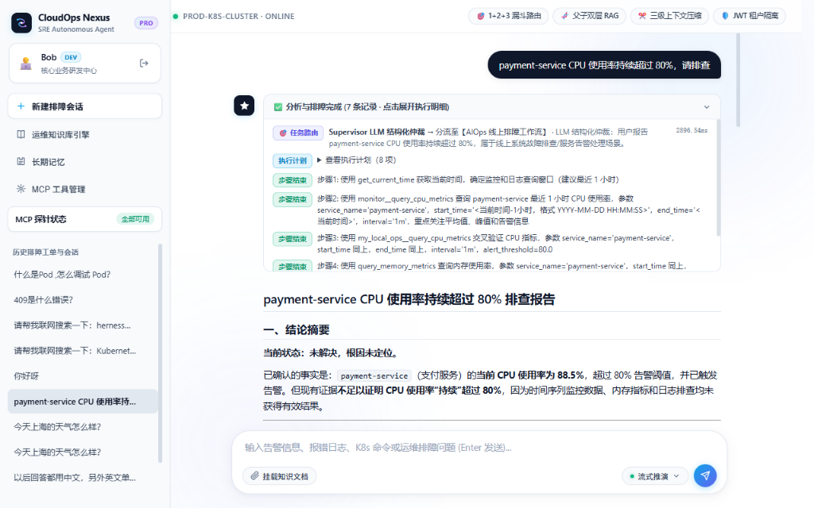
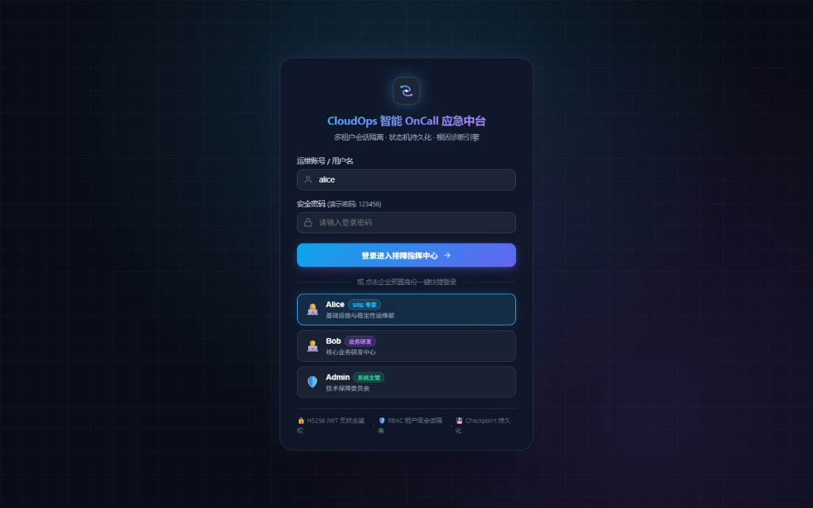
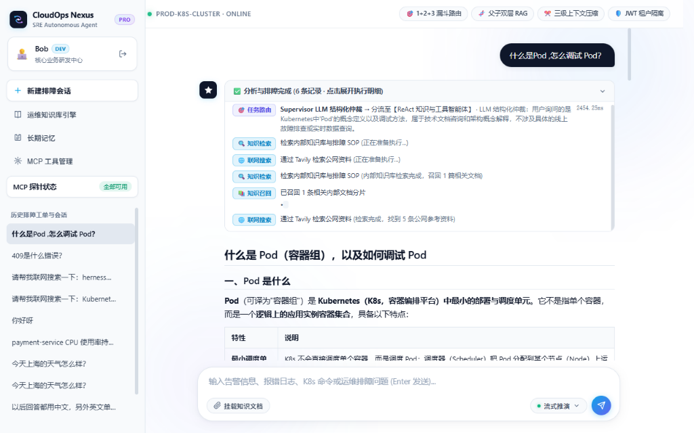
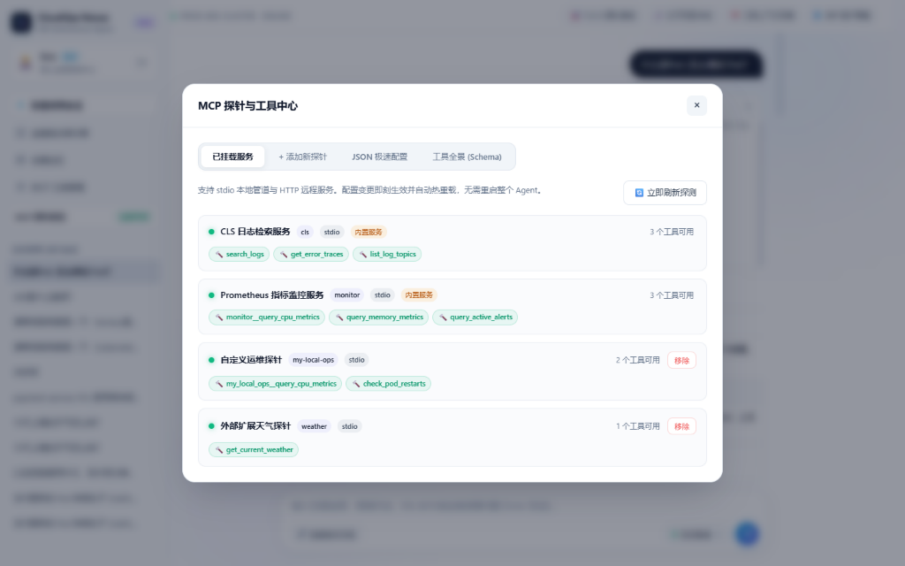
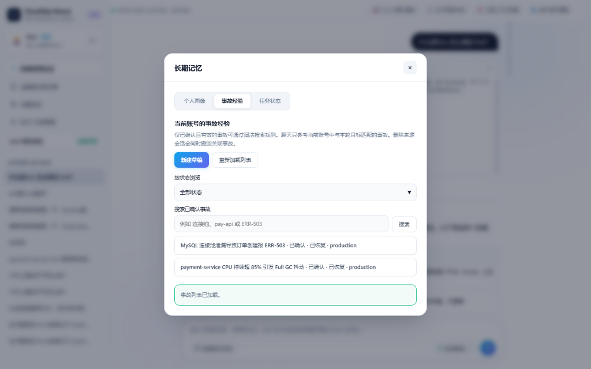
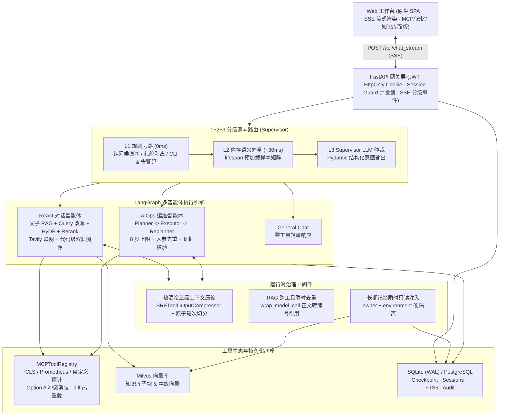
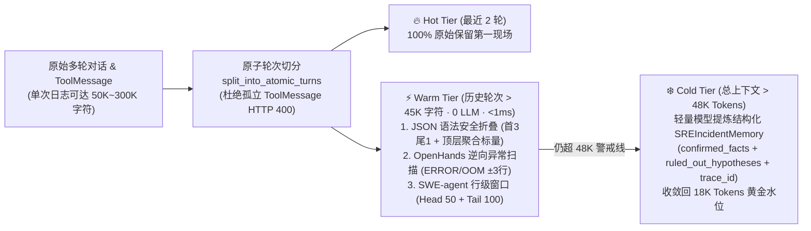
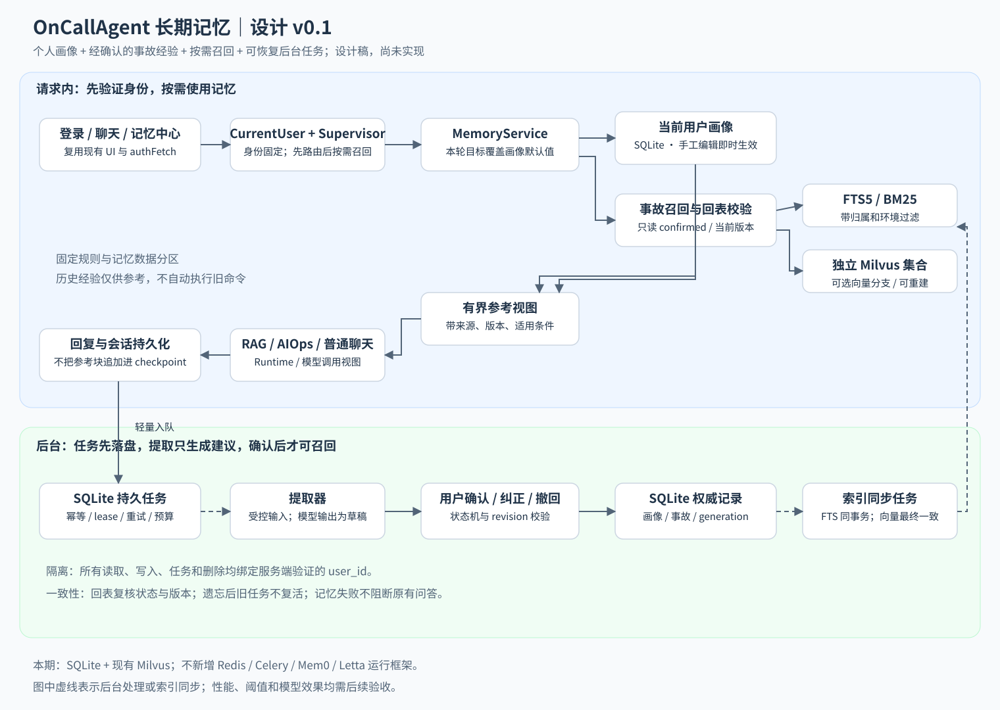

<div align="center">

# CloudOps Nexus · OnCall Agent

**面向生产级 SRE 值班场景的自主多智能体运维与知识中台**

*1+2+3 分级漏斗路由 · 父子双层进阶 RAG · Plan-Execute-Replan 排障 · 热温冷三级上下文压缩 · MCP 热重载与消歧 · 防投毒人机闭环长期记忆*

<p>
  <a href="https://www.python.org/"></a>
  <a href="https://fastapi.tiangolo.com/"></a>
  <a href="https://langchain-ai.github.io/langgraph/"></a>
  <a href="https://milvus.io/"></a>
  <a href="https://modelcontextprotocol.io/"></a>
  
</p>

<p>
  <a href="#-核心能力矩阵">✨ 核心能力</a> ·
  <a href="#-界面全景预览">📸 界面预览</a> ·
  <a href="#-系统架构设计">🏗️ 系统架构</a> ·
  <a href="#-核心工程特性深度解析">🧠 工程细节</a> ·
  <a href="#-快速开始">🚀 快速开始</a> ·
  <a href="#-核心-api-接口">📡 API 接口</a> ·
  <a href="#-进阶架构文档">📚 技术文档</a>
</p>

<br/>



</div>

---

## 🎯 项目背景

在一线 SRE / OnCall 值班场景中，传统运维助手往往面临四个真实工程痛点：
1. **重复咨询打扰多**：80% 的高频错误码与配置规范已沉淀在内部 Wiki/SOP 中，但检索困难导致值班人员反复充当“人肉客服”。
2. **跨系统排障割裂**：故障定位需要在日志平台（CLS）、时序监控（Prometheus）与 SOP 手册之间来回切换，纯 ReAct 在 5~8 步深度排障中容易目标漂移或死循环。
3. **长日志上下文爆炸**：单次日志/指标返回动辄数万至数十万字符，直接灌入 Prompt 引发注意力衰减与延迟雪崩；粗暴截断则会破坏 JSON 语法或切掉堆栈尾部根因。
4. **故障经验难以安全复用**：通用记忆框架（如无审核自动入库）极易把排查中途的错误推测当成事实沉淀，引发**记忆投毒**与跨环境串染。

**CloudOps Nexus（OnCall Agent）** 围绕上述痛点，基于 **FastAPI + LangGraph + Milvus + MCP** 构建了一套完整、可控、可观测的企业级智能运维工作台。

---

## ✨ 核心能力矩阵

| 核心维度 | 工程落地与关键机制 | 核心代码模块 |
| :--- | :--- | :--- |
| **🚦 1+2+3 分级漏斗路由** | 规则旁路（纯问候直通 + 混合句礼貌语剥离 + CLI/告警特征匹配）→ 内存语义向量路由 → Supervisor LLM 结构化仲裁；FastAPI `lifespan` 启动预热，SSE 首包推送 `route` 轨迹 | [`app/agent/supervisor.py`](app/agent/supervisor.py) |
| **📚 分层进阶 RAG 引擎** | `ParentDocumentRetriever` 存搜分离（1600 字父块存本地 KV / 400 字子块入 Milvus）、有界历史 Query 改写（Fast-Pass 放行 + `enable_thinking=False` 防截断 + 错误码字面量回退）、条件 HyDE 双轨召回、千问 Cross-Encoder 精排、`wrap_model_call` 中间件瞬时去重 | [`app/services/parent_document_service.py`](app/services/parent_document_service.py)<br/>[`app/services/knowledge_retrieval_service.py`](app/services/knowledge_retrieval_service.py) |
| **🧭 Plan-Execute-Replan 排障** | Planner 先查内部 SOP 生成结构化诊断步骤 → Executor 多轮取证 + 入参签名去重防死循环 → Replanner 动态评估收敛；内置 8 步硬上限与关键证据校验 | [`app/agent/aiops/`](app/agent/aiops/) |
| **🗜️ 热温冷三级上下文压缩** | **Hot（最近 2 轮）** 原样保留 → **Warm（>45K 字符，0 次 LLM）** JSON 语法折叠 + OpenHands 逆向异常行扫描 + SWE-agent 首尾视窗 → **Cold（>48K Tokens）** 提炼结构化工作记忆（`confirmed_facts` / `ruled_out_hypotheses`）；按原子轮次切分根治孤立 `ToolMessage` HTTP 400 | [`app/agent/compactor.py`](app/agent/compactor.py) |
| **🔌 企业级 MCP 生态与消歧** | 支持 `stdio` 与 `streamable-http` 双传输；与 Claude Desktop 互通的 `mcp_servers.json` + Web 可视化四标签管理面板 + diff 增量热重载；**Option A 自动前缀消歧**根治多服务同名工具引发的 BNF 语法编译超时；单服务异常独立隔离降级并后台自愈重连 | [`app/agent/mcp_client.py`](app/agent/mcp_client.py)<br/>[`static/mcp-manager.js`](static/mcp-manager.js) |
| **🧠 防投毒人机闭环长期记忆** | 分层解耦（个人运维画像 + 事故经验库）；三阶段混合提炼（正则脱敏 + 轻量 LLM 提取 + Python 逐字引文校验）；强制 `recovery_evidence` 核验与人工审核确认；**编辑核心事实强制回退 `draft` 并联动清理 FTS5 与 Milvus 索引**；检索前按 `owner` + `environment` 硬隔离 | [`app/services/memory_extraction_service.py`](app/services/memory_extraction_service.py)<br/>[`app/services/memory_retrieval_service.py`](app/services/memory_retrieval_service.py)<br/>[`app/storage/memory_incidents.py`](app/storage/memory_incidents.py) |
| **🔐 多租户鉴权与零构建前端** | HS256 JWT（HttpOnly Cookie + Bearer Header 双轨）与注销吊销表；三层租户隔离（业务 SQL 属主校验 + `{user_id}:{session_id}` Checkpoint 隔离 + 记忆前置过滤）；单会话异步互斥锁防并发重入；纯原生 HTML/CSS/JS 单页零构建交付 | [`app/api/auth.py`](app/api/auth.py)<br/>[`app/api/session_guard.py`](app/api/session_guard.py)<br/>[`static/`](static/) |

---

## 📸 界面全景预览

<table>
  <tr>
    <td width="50%">
      <strong>1. 多租户安全登录与 RBAC 身份切换</strong><br/>
      <sub>HS256 JWT HttpOnly Cookie 鉴权 · 预置 SRE / Dev / Admin 演示角色</sub>
      <br/><br/>
      
    </td>
    <td width="50%">
      <strong>2. ReAct 知识库与 Tavily 联网双轨混合问答</strong><br/>
      <sub>路由透明追踪 · 内部 SOP 召回 + 公网检索双轨溯源 · 结构化表格渲染</sub>
      <br/><br/>
      
    </td>
  </tr>
  <tr>
    <td width="50%">
      <strong>3. MCP 探针与工具中心（热重载 & 冲突消歧）</strong><br/>
      <sub>已挂载服务状态监控 · 表单/JSON 热配置 · 自动前缀消歧（<code>monitor__</code> vs <code>my_local_ops__</code>）</sub>
      <br/><br/>
      
    </td>
    <td width="50%">
      <strong>4. 长期记忆治理中心（防投毒人机闭环）</strong><br/>
      <sub>个人画像 + 事故经验 + 后台任务三视图 · 状态流转与 FTS5/Milvus 双路检索</sub>
      <br/><br/>
      
    </td>
  </tr>
</table>

---

## 🏗️ 系统架构设计

### 1. 端到端多智能体与基础设施架构



### 2. 热温冷三级上下文压缩流水线



### 3. 防投毒长期记忆架构总览

<div align="center">
  
</div>

---

## 🧠 核心工程特性深度解析

<details>
<summary><strong>1. 父子两级召回 + 条件 HyDE + 跨工具动态去重</strong></summary>

- **存搜分离**：采用 `MarkdownTextSplitter` 将 SOP 文档切分为 `1600` 字符父块（落盘 `LocalFileStore`）与 `400` 字符（重叠 `80`）子块（向量化写入 Milvus），检索命中子块后按 `parent_id` 回取完整父文档；并通过 `sources.sqlite` 版本指纹实现增量无损更新。
- **防截断多轮改写**：CLI 命令及自包含长句 0ms Fast-Pass 直通；命中代词时显式配置 `extra_body={"enable_thinking": False}` 防止思考模型耗尽输出 Token；正则提取错误码字面量，改写丢失即毫秒级回退原始 Query。
- **条件 HyDE + 精排安全气囊**：仅开放机理类问题触发假设文档生成，并与原句向量在 `RunnableParallel` 中双轨检索，最终交由千问 Cross-Encoder 重排过滤跑偏候选。
- **零污染视图去重**：通过 `wrap_model_call` 中间件在请求模型前将同一轮重复命中的父文档折叠为编号引用提示，底层 LangGraph Checkpoint 原始消息保持不变。

</details>

<details>
<summary><strong>2. 多 MCP 协同冲突消歧（Option A）与无感热重载</strong></summary>

- **解决痛点**：多 MCP Server 注册同名工具（如内置 `monitor` 与自定义 `my-local-ops` 同名 `query_cpu_metrics`）时，既会导致 `ToolNode` 静默覆盖，也会触发模型侧受限解码 BNF 语法编译器超时。
- **Option A 消歧**：全局唯一工具保持短名（不破坏 SOP 文档引用）；仅对冲突工具在内存中克隆重命名为 `{safe_server_name}__{tool_name}` 并注入 `[来源服务: xxx]` 描述，使 Agent 能够自主实现多源监控交叉验证；本地核心工具受 `LOCAL_TOOL_NAMES` 最高优先级保护。
- **增量 diff 热重载**：`MCPToolRegistry.reload_config()` 在异步锁下比对配置指纹，仅重建变更/移除的会话，健康连接保持复用，单服务断连自动返回 `CallToolResult(isError=True)` 降级并进入后台自愈队列。

</details>

<details>
<summary><strong>3. 长期记忆三道防投毒防线</strong></summary>

1. **三阶段混合提炼**：正则预筛真实故障并脱敏密钥 → 轻量模型（`enable_thinking=False, temperature=0`）按 Pydantic Schema 抽取 → Python 代码硬校验每条引文在原消息中逐字存在（`quote in row["text"]`）。
2. **形式系统验 + 真伪人类判**：标为 `resolved` 强制要求附带合法监控 URL（禁带凭据）或经 SQL 核验的真实 `source_message_ids`；业务真伪由 SRE 审核确认并写入不可篡改 `ltm_audit` 审计日志。
3. **编辑即下线**：通过 `PATCH /api/memory/incidents/{mid}` 修改核心事实时递增 `revision`、强制打回 `draft` 状态、立即清理 SQLite FTS5 索引并派发后台任务从 Milvus 清除向量，重审前彻底退出召回。

</details>

---

## 🚀 快速开始

### 环境要求
- **Python**: `3.11 ~ 3.13`
- **向量数据库**: Milvus 2.x（本地 Docker Compose 或远程 SSH 隧道）
- **模型密钥**: 千问平台 API Key（`QWEN_API_KEY`）；如需联网搜索，可选配置 `TAVILY_API_KEY`

### 1. 克隆项目与安装依赖

```bash
git clone https://github.com/YAOLQ2024/OnCall-Agent.git
cd OnCall-Agent

# 推荐使用 uv 安装（更快）
uv venv
source .venv/bin/activate        # Windows: .venv\Scripts\activate
uv pip install -e ".[dev]"
```

### 2. 配置环境变量

```bash
cp .env.example .env
```

编辑 `.env`，至少填入：

```env
QWEN_API_KEY=your_qwen_api_key
MILVUS_HOST=localhost
MILVUS_PORT=19530

# 可选：开启联网搜索 / 精排 / 长期记忆 / LangSmith 追踪
TAVILY_API_KEY=
RAG_RERANK_ENABLED=true
LTM_ENABLED=true
LANGSMITH_TRACING=false
```

### 3. 启动 Milvus 与主服务

#### Linux / macOS
```bash
# 启动本地 Milvus 向量库
docker compose -f vector-database.yml up -d

# 启动 FastAPI 主服务（内置 CLS / Monitor MCP 服务自动以 stdio 托管启动）
python -m uvicorn app.main:app --host 0.0.0.0 --port 9900
```

#### Windows（PowerShell / CMD）
```powershell
# 一键启动（本地 Milvus + 主服务）
.\start-windows.bat

# 或通过 SSH 隧道连接云端 Milvus 启动（需在 .env 配置 ONCALL_MILVUS_SSH_TARGET=user@host）
.\scripts\start-cloud.ps1
```

### 4. 访问工作台与演示账号

- **Web 运维工作台**：`http://localhost:9900`
- **Swagger API 文档**：`http://localhost:9900/docs`

系统内置三个预置角色账号（演示密码均为 **`123456`**），可在登录页一键切换体验多租户会话与记忆隔离：

| 用户名 | 角色标识 | 部门 / 定位 |
| :--- | :--- | :--- |
| `alice` | `SRE` | 基础设施与稳定性运维部（SRE 核心排障专家） |
| `bob` | `DEV` | 核心业务研发中心（交易业务研发工程师） |
| `admin` | `ADMIN` | 技术保障委员会（运维系统管理员） |

---

## 📡 核心 API 接口

| 模块 | 方法 | 路径 | 说明 |
| :--- | :--- | :--- | :--- |
| **身份鉴权** | `POST` | `/api/auth/login` · `/api/auth/logout` | HS256 JWT 登录（下发 HttpOnly Cookie）与吊销登出 |
| **会话管理** | `GET/POST/DELETE` | `/api/sessions` · `/api/sessions/{id}/messages` | 多租户会话列表、历史消息与执行轨迹读取 |
| **智能对话** | `POST` | `/api/chat_stream` · `/api/chat` | SSE 分级流式对话（自动触发 1+2+3 漏斗路由） |
| **AIOps 诊断** | `POST` | `/api/aiops` | Plan-Execute-Replan 自主故障排障流 |
| **知识库引擎** | `POST` | `/api/upload` · `/api/index_directory` · `/api/knowledge/search` | 文档增量上传、目录父子索引重建与检索测试 |
| **MCP 工具中心** | `GET/POST` | `/api/tools/status` · `/api/tools/config` · `/api/tools/refresh` | 探针状态监测、`mcp_servers.json` 在线热重载 |
| **长期记忆** | `GET/PATCH/POST` | `/api/memory/profile` · `/api/memory/incidents` · `/api/memory/jobs` | 个人画像、事故草稿/确认/下线与后台提炼任务治理 |
| **健康检查** | `GET` | `/health` | 服务与依赖健康探针 |

---

## 📁 项目结构

```text
OnCall-Agent/
├── app/
│   ├── main.py                             # FastAPI 入口、lifespan 预热与后台 Worker 管理
│   ├── config.py                           # Pydantic Settings 配置中心与 MCP 规范解析
│   ├── api/                                # REST & SSE 路由层
│   │   ├── auth.py                         # HS256 JWT 鉴权、Cookie/Bearer 解析与吊销校验
│   │   ├── sessions.py & session_guard.py  # 多租户会话接口与单会话并发防重入互斥锁
│   │   ├── chat.py & aiops.py              # SSE 流式对话与自主排障入口
│   │   ├── memory.py                       # 长期记忆画像、事故治理与任务 API
│   │   ├── tools.py                        # MCP 状态查询与热重载配置 CRUD
│   │   └── knowledge.py & file.py          # 知识检索与文档增量索引接口
│   ├── agent/                              # Agent 核心编排与运行时治理
│   │   ├── supervisor.py                   # 1+2+3 分级漏斗路由引擎
│   │   ├── compactor.py                    # 热温冷三级上下文压缩与原子轮次切分
│   │   ├── mcp_client.py                   # MCP 双传输管理、Option A 消歧与 diff 热重载
│   │   ├── memory_context_middleware.py    # 长期记忆只读瞬时注入中间件
│   │   └── aiops/                          # Plan-Execute-Replan 节点 (planner/executor/replanner/state)
│   ├── services/                           # 业务与检索服务层
│   │   ├── rag_agent_service.py            # ReAct 对话 Agent 与去重中间件组装
│   │   ├── parent_document_service.py      # 父子两级召回与 SQLite 版本增量管理
│   │   ├── knowledge_retrieval_service.py  # 多轮 Query 改写、条件 HyDE 与千问 Rerank
│   │   ├── memory_*.py                     # 长期记忆提取、双路召回、向量同步与后台 Worker
│   │   └── aiops_service.py                # 运维诊断状态图服务
│   ├── storage/                            # 持久化引擎 (SQLite WAL / FTS5 / 审计日志)
│   └── tools/                              # 本地核心工具 (知识库检索、基准时间、Tavily 联网)
├── mcp_servers/                            # 内置 & 示例 FastMCP 服务端探针
│   ├── cls_server.py                       # 模拟 CLS 生产日志检索探针
│   ├── monitor_server.py                   # 模拟 Prometheus 时序指标探针
│   ├── my_monitor_mcp.py                   # 自定义本地监控探针（演示多源交叉验证与消歧）
│   └── weather_server.py                   # 轻量外部扩展探针示例
├── static/                                 # 零构建原生前端 SPA (HTML5/CSS3/ES6)
│   ├── index.html & styles.css & app.js    # 主工作台、SSE 思考轨迹渲染与多租户鉴权
│   ├── mcp-manager.js                      # MCP 四标签可视化管理面板
│   └── memory-incidents.js & memory-jobs.js# 长期记忆治理抽屉与任务状态页
├── docs/                                   # 架构设计文档、验收记录与系统截图
├── tests/                                  # Pytest 后端单测 & Node 无头前端契约测试
├── mcp_servers.json                        # 外部 MCP 扩展配置（兼容 Claude Desktop 格式）
└── vector-database.yml                     # Milvus 本地 Docker Compose 编排
```

---

## 🧪 自动化测试

项目同时覆盖后端核心引擎（路由、三级压缩、MCP 消歧与热重载、多租户安全、长期记忆防投毒状态机）与前端原生交互契约测试：

```bash
# 运行后端 Pytest 测试套件
pytest

# 运行前端原生无头契约测试 (Node.js 20+)
node --test tests/*.test.cjs
```

---

## 📚 进阶架构文档

- [🔍 检索增强架构决策（父子召回 / 改写 / 条件 HyDE / 精排）](docs/retrieval-architecture.md)
- [📘 检索模块开发与验收指南](docs/retrieval-development.md)
- [🧠 长期记忆防投毒架构设计](docs/long-term-memory-architecture.md)
- [🛠️ 长期记忆开发与测试规范](docs/long-term-memory-development.md)
- [🔭 LangSmith 全链路可观测性接入](docs/observability.md)
- [🔐 登录鉴权与多租户会话隔离评审](docs/login-review.md)

---

## 📄 License

本项目仅供学习、研究与企业内部 SRE 智能化实践参考。
