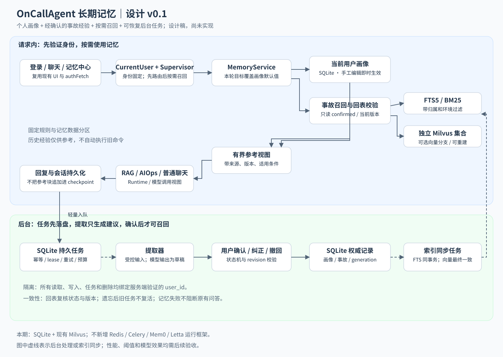
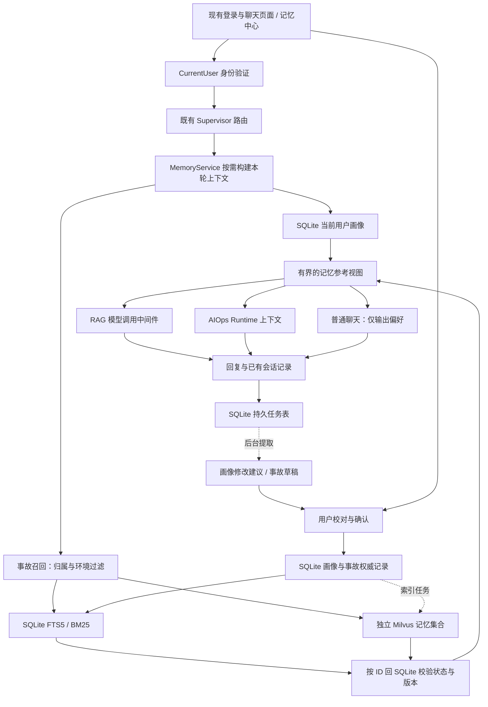
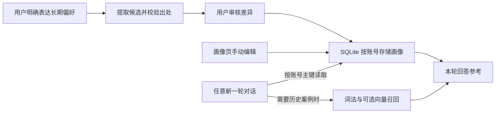
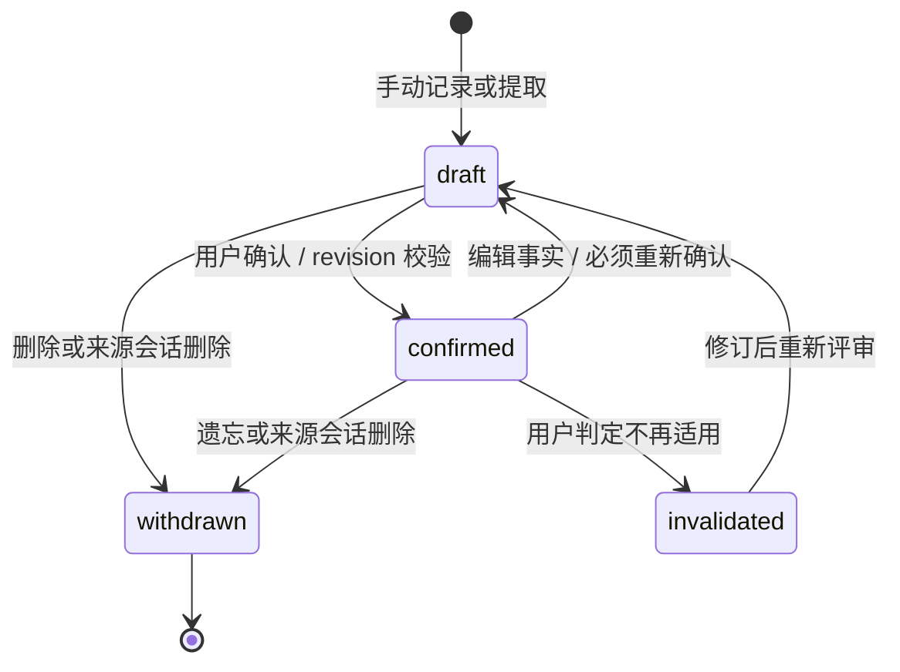
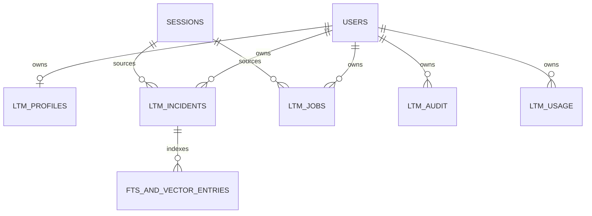
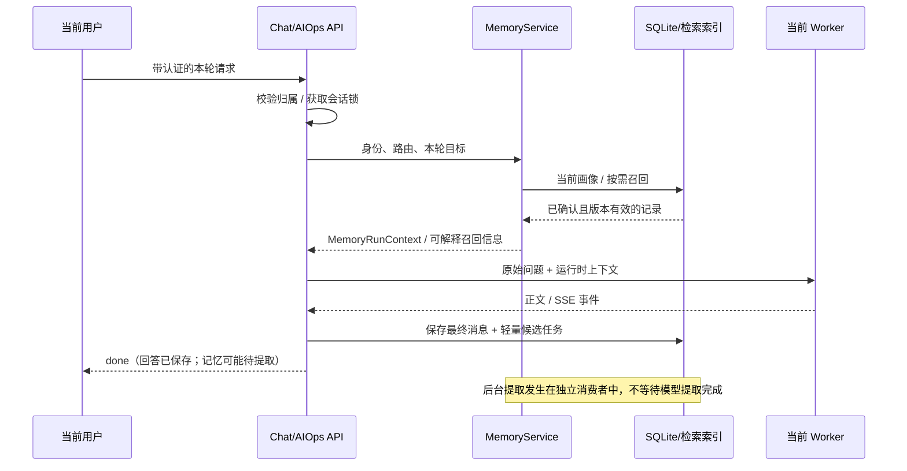
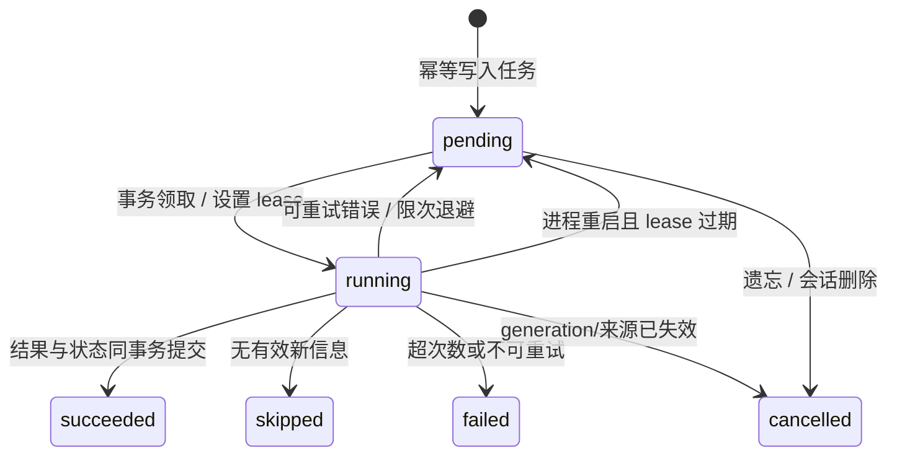

# OnCallAgent 长期记忆架构

版本 v0.4，更新于 2026-11-09。M1 画像管理、M2 事故管理和 M3 聊天召回已实现。M3 已通过运行验收。M4 自动提取、审核、自然语言回答偏好和遗忘已通过临时应用与测试模型验收。

配套文档：[开发与验收](long-term-memory-development.md)。本文恢复“个人画像＋历史事故经验＋按需召回＋后台提炼”的完整方案，并纳入此前评审补充；不采用仅接 Mem0 的缩减方案。开源项目提供设计参考，本版不同时引入 LangMem、Mem0、Letta 的运行框架，也不新增 Redis、Celery 或 PostgreSQL。

## 1. 目标、现状与边界

目标是让用户在新会话中复用已确认的偏好、环境默认值和适用的历史事故经验，同时保留证据、纠正与删除能力。不能据此宣称自动根因定位成功或生产环境可直接执行修复命令。

| 对象 | 当前实现／拟新增职责 | 生命周期 |
| --- | --- | --- |
| 登录身份 | 现有 `app/api/auth.py` 验证 JWT，API 使用 CurrentUser | 登录凭证；不能由模型或请求体伪造 user_id |
| 会话与 checkpoint | 现有 SQLite 消息表及隔离后的 RAG/AIOps thread | 当前会话恢复；不迁移、不重写已有 checkpoint |
| 结构化工作摘要 | 现有 `app/agent/compactor.py` 的 SREIncidentMemory | 当前模型调用／会话工作信息；名字里有 Long-Term 不代表跨会话存储 |
| 个人画像 | 当前用户确认的结构化偏好、自然语言回答偏好与环境默认选择 | 跨会话；可编辑、清空与暂停使用 |
| 事故经验 | 新增、带来源和适用条件的复盘记录 | 草稿先确认，确认后参与召回，可失效或撤回 |
| 静态知识库 | 既有 ParentDocumentRetriever、Milvus 与查询增强链路 | SOP/官方文档；和事故经验分集合、分来源展示 |

本期全部记忆按真实 user_id 私有隔离；不把 user_id 宣称为完整组织多租户体系。暂不实现团队共享、组织 RBAC、自动修改系统行为的程序性记忆、自动执行历史止血命令和图记忆。Admin 也不能读取其他账号私有记忆。

保留当前前端风格。未来记忆中心复用现有按钮、dialog、卡片及颜色变量；登录页、现有聊天布局和横屏行为不重新设计。

## 2. 总体架构图

图中虚线表示异步索引或后台任务。SQLite 是记忆内容、归属、状态和版本的权威来源；Milvus、FTS 都是可重建的检索索引。Redis 和新数据库服务不在本期依赖中。

## 3. 模块选择与职责

| 模块 | 决策与职责 |
| --- | --- |
| MemoryService | 统一领域入口，接受服务端身份，协调画像、事故、任务与召回；不是第二个 Agent |
| SQLite repository | 使用现有数据库路径，参数化 SQL、WAL、短事务；不使用跨请求全局当前用户 |
| Profile policy | 白名单字段、字段来源、显式 patch、版本校验；模型只能提出修改建议 |
| Incident extractor | 通过现有 LLMFactory + Pydantic 输出复盘草稿，不能确认成功、直接删记忆或执行工具 |
| Recall engine | FTS/BM25＋可选向量召回、RRF 合并、环境过滤、回表校验与预算裁剪 |
| Memory context middleware | 将有界参考视图加入本次模型请求，不追加进持久 messages |
| Durable worker | lifespan 管理的后台消费者；进程重启从 SQLite 任务记录恢复 |
| HTTP/UI | 查看、编辑、确认、撤回、遗忘、任务状态；全部复用当前登录与 authFetch |

概念上参考 LangGraph 的跨线程 namespace 与 LangMem 的语义／情景记忆。现阶段直接用现有 LangChain 结构化输出提取，不新增 LangMem 依赖。若后续试用 LangMem，仅替换 extractor，不能绕开现有归属、确认和写入策略。[LangGraph](https://docs.langchain.com/oss/python/concepts/memory)、[LangMem](https://langchain-ai.github.io/langmem/concepts/conceptual_guide/)

## 4. 记忆内容与可信规则

### 4.1 画像

常见设置继续使用结构化字段。其余通用回答偏好以 `response_preferences` 短句列表存进同一个 `ltm_profiles.profile_json`。个人画像页以每行一条的文本框展示并编辑，保存时使用原有画像版本校验。旧画像省略此键，读取时按空列表处理。

LLM 对明确的长期要求生成待审核建议。自由文本用用户原话片段表达，可提议新增、改写或移除已有条目；旧值由服务端核对，审阅页展示列表变化和出处。审核后才更新本账号画像。结构化字段要有明确证据，术语翻译要求应写成「英文术语旁附上中文翻译」一类的句子。

通用回答偏好随当前账号画像一起读取，供普通聊天、知识问答和 AIOps 使用。本轮明确要求优先，环境与工具安全约束优先于画像。自然语言偏好只影响回答表达，环境筛选继续使用受校验的结构化设置。

结构化字段包括 `preferred_language`、`answer_detail`（concise/normal/detailed）、`preferred_output_order`（summary_first/steps_first）、`default_cluster`、`default_environment`、`default_namespace`、`responsible_services`。密码、Token、完整日志、系统指令、工具授权与命令均超出画像用途。

环境字段是用户确认的默认选择，不是当前生产状态或执行权限。当前问题明确指定的集群、环境、namespace 优先；有歧义时询问用户。当前系统没有组织授权模型，不能因画像里出现 prod 就声称有操作 prod 的权限。

表单修改经校验立即保存并返回新版本，零 LLM 调用。“记住／以后默认”等自然语言先形成建议，用户确认后应用；“这次／临时／假设／演练／别人负责”不自动变成长期事实。正则是候选门控，不是安全防线。

优先级：本轮明确要求 > 人工确认的当前画像 > 尚未确认的提取建议（不生效）。更新使用字段 patch 和 expected_revision，禁止模型提交整份旧 JSON 覆盖用户刚修改的新值。已删除字段不因旧任务回写而恢复。

### 4.2 事故经验

必要字段：标题、症状、目标服务、集群/环境/namespace、发生时间、适用版本、诊断动作与证据引用、已排除假设及证据、根因（允许未知）、采取的操作、恢复证据、复盘结论、来源会话及消息范围。

`workflow complete`、答案包含“根因”、答案很长、模型自报 confidence 高，都不能构成已解决的证据。首版只由当前用户显式确认经验，不实现自动证据判定后晋级。

confirmed 记录仍需单独保存 outcome：resolved / unresolved。resolved 要有恢复证据引用和用户确认；unknown root cause 不能被改写成确定根因。未解决但已确认的记录可作为“未解决案例”参考，不能以成功修复示例呈现。

“已排除假设”只在原事故的条件与时间范围内成立。相似案例可以建议优先验证连接池，但不能命令本轮跳过 CPU。当前监控、工具证据及适用条件优先于旧案例；历史修复命令是带风险说明的参考文本，不授予执行权限。

### 4.3 安全与来源

身份只取验证后的 CurrentUser；请求模型不接受 owner_id，后台任务在创建时固化 owner_id。所有 list/get/edit/confirm/search/job/delete API 逐条核对归属；不存在或越权统一 404。

记忆来自用户与日志，按不可信参考数据处理。系统固定规则与记忆数据分区；字段、长度和枚举均经校验。日志中的“忽略规则”等内容不能进入系统规则、工具授权或身份字段。前端以 textContent/转义显示，不插入未经清洗的 HTML。

每条展示记录保留来源 ID、revision、确认状态、时间、适用条件；SSE 只展示“召回依据”，不展示模型内部推理。任务和 trace 只记录 ID、数量、耗时、错误类别，敏感正文不默认进入远程追踪。

## 5. 数据设计

不变更已有 users、sessions、messages、checkpoints、writes、blobs 的语义；新增表名统一 ltm_ 前缀，使用事务化、可重复的 schema migration。迁移前通过 SQLite backup API 备份，不能在 WAL 开启时简单复制单个 db 文件。

| 表／索引 | 关键字段与约束 |
| --- | --- |
| ltm_profiles | user_id PK/FK，profile_json，field_sources_json，revision，generation，use_enabled，auto_extract_enabled，updated_at；默认空画像 |
| ltm_incidents | memory_id PK，user_id，status，outcome，revision，generation，title，cluster/environment/namespace，incident_json（含服务、版本约束、来源消息和证据），identifiers_json，source_session_id，content_hash，confirmed_by，confirmed_at，created_at/updated_at，expires_at |
| ltm_jobs | job_id PK，user_id，kind，memory_id，session_id，idempotency_key UNIQUE，expected_generation，expected_revision，source_hash，status，attempt_count，lease_until，next_attempt_at，payload_json，result_json，error_code，created_at/updated_at |
| ltm_audit | event_id PK，user_id，memory_id/字段路径，操作类型，旧／新 revision，来源类型，时间；不存密钥或原始长日志 |
| ltm_usage | reservation_id PK，user_id，job_id/request_id，调用类型，模型、输入/输出预留与实用 token、embedding 文本数量、状态、时间；额度在事务内预留 |
| ltm_incidents_fts | FTS5 虚拟表：memory_id/user_id/revision/normalizer_version UNINDEXED，normalized_tokens；仅索引 confirmed、未撤回正文摘要，可随时重建 |
| oncall_long_term_incidents | 独立 Milvus collection：vector_id PK，memory_id，user_id，revision，generation，content_hash，标量环境字段，embedding；独立于知识库集合 |

重要约束：

- status 只允许 draft/confirmed/invalidated/withdrawn；所有可检索记录必须 confirmed、未过期、归属正确。
- revision 每次编辑或状态变更递增；profile generation 在“遗忘全部”时递增，旧任务立即失效。
- 同一 confirmed revision 的向量 ID 由 memory_id + revision + embedding schema 标识稳定派生，重复索引不产生额外副本。
- 索引结果一定按 ID 回 SQLite 复查 owner/status/revision/generation/content_hash；旧向量即使未及时清理也不能被注入。
- 默认私有；暂不建立 organization/team 表或分享 API。将来新增共享必须另开设计，不能默认跨 user_id 搜索。
- 五张普通表＋一张 FTS 虚拟表是完整目标；分阶段只创建当前阶段所需表，不先搭未使用的存储。

ER 图中的来源关联是逻辑关系；删除处理由 repository 在同一 SQLite 事务内执行，不使用阻止既有会话删除的强制 RESTRICT 外键。

## 6. 读取链路

画像读取使用 `ltm_profiles.user_id` 主键索引，取当前账号一行并解析 JSON。自然语言偏好与结构化字段共用这次读取及现有上下文预算。图内复用请求视图，每轮可读到最新确认版本。历史事故是另一条链路，才按本轮问题做关键词匹配与可选的向量近邻检索。

1. API 验证身份并捕获一次 MemoryRunContext：user_id、session_id、request_id、profile_generation、本轮明确环境字段。JWT 和原始口令不进入图状态或 prompt。
2. 既有 Supervisor 按当前问题路由；不先为每句寒暄做事故向量检索。
3. 普通聊天可使用已确认的语言、详细度和自然语言回答偏好。知识问答与 AIOps 再按问题决定是否召回事故。
4. 读取画像后，将本轮明确环境覆盖默认值。精确环境不一致的事故直接排除；环境未知的事故不能被当作同生产环境的可执行修复依据。
5. 事故库的 FTS 与可选向量查询并行，带 user_id 和适用环境过滤。每轮至多执行一次记忆 query embedding。图内多次工具循环复用同一参考视图。
6. 以 RRF 合并两个排名，再回表验证和裁剪。当前每路候选默认 10，最终最多 3 条，RRF 常数为 60。这些值可用实际排障样本校准。
7. 画像、事故及其使用规则共享 32,768 个估算 token。事故带完整的症状、根因、恢复观察和复盘结论；超限时优先省略次要说明或减少事故数量，保留适用条件和“未解决”标记。
8. recall 失败降级为画像或无记忆；不影响原有 RAG、模型工具调用或正常返回。

FTS 使用 SQLite FTS5 的 bm25 排名。默认 unicode61 不等于中文分词；设计要求共享、版本化的 normalizer 保留服务名/错误码等完整字面量并补充中文字符片段，索引与查询采用同一规则。查询 token 逐个转义，不能把用户输入原样当 MATCH 语法。FTS5 不可用时提供受限的精确标识符匹配，返回明确 degraded 状态，不伪称 BM25。[SQLite FTS5](https://sqlite.org/fts5.html)

向量复用当前配置的 embedding 模型、维度与 Milvus 地址，单独配置记忆集合；维度/模型变化必须换 embedding_schema 并重建记忆索引。新功能不修改原父子召回集合。Milvus 标量过滤是第一道约束，回表验证是最终授权检查。[Milvus 过滤检索](https://milvus.io/docs/filtered-search.md)

## 7. 与现有 Agent 的接入

- RAG：create_agent 使用已安装版本支持的 context_schema；MemoryContextMiddleware 读取本轮 runtime.context。先完成既有历史压缩/本轮文档去重，再通过 ModelRequest.override 构造模型调用视图；参考数据与固定 system policy 分隔，不把整段记忆追加到 state.messages。
- AIOps：StateGraph 增加运行时 context_schema，planner/executor/replanner 通过 Runtime 读取同一个有界 MemoryRunContext；不能只改初始 input 而让后续节点看不到记忆。
- 普通聊天：general_chat_messages 仅加入安全的输出偏好，事故记忆不影响 Supervisor 决策。
- 现有 compactor 的工作摘要继续只服务当前会话；不自动提升为跨会话 confirmed 事故，不将长期记忆再次汇总后回存。
- query/query_stream/execute/diagnose 的正式 HTTP 调用必须显式传入已验证用户；旧默认 Alice 只可保留给测试兼容，不可作为记忆接口身份回退。
- MemoryRunContext 不保存到 checkpoint；每轮重新读取，保证纠正/撤回后下轮不使用旧版本。正在执行的请求使用开始时快照，不承诺中途更新。

## 8. 后台提炼与索引同步

后台消费者是 lifespan 内受管理的任务；`asyncio.create_task` 仅负责启动消费者，不负责保存任务事实。任务先落 SQLite，进程重启后按 lease 恢复。

任务类型：extract_profile_proposal、extract_incident_draft、index_incident、purge_incident_index。普通表单修改不经过 LLM。

- 幂等键含 user_id、来源会话、最终消息 ID、任务类型、extractor schema；重复 SSE/重试不重复提炼。
- 消费者在领取、模型返回后及提交前复核 generation、来源是否仍存在、expected_revision。模型调用期间不持有 SQLite 写锁。
- 提取输入来自消息表已完成的有界对话及允许的证据快照，不能直接把任意全量工具日志发给模型；脱敏后再处理。
- 字数／关键词只决定是否尝试生成草稿，不决定事实确认。普通寒暄和纯概念问答不触发事故提炼。
- 同一次提取最多调用一次结构化模型；输出含字段级证据引用与 ADD/UPDATE/REMOVE/NOOP 提议；仅白名单校验后的建议进入待确认结果。
- 任务结果默认等待用户确认；模型不得直接物理删除 confirmed 记录。
- 画像并发编辑返回 409，不用旧结果覆盖新值；事故编辑将其退回 draft，并更新检索索引状态。
- 事故确认与 index_incident 任务在同一 SQLite 事务提交；索引失败保留任务，词法召回可用；索引成功后仍需回表确认。
- 失败、取消或用户断开但未持久化最终回复的轮次，不自动提取事故；后台不对前端提前宣称“已记住”。

## 9. 删除、遗忘与一致性

| 操作 | 确定行为 |
| --- | --- |
| 删除普通会话 | 同事务取消该会话未完成提取任务、撤回该会话派生的事故及草稿、清理对应 FTS，排入向量清理任务；原有消息/checkpoint 删除继续执行 |
| 删除会话与画像 | 已由用户手动确认的画像视为独立个人设置，不随会话删除；页面需明确说明；自动提取的未确认建议随来源删除取消 |
| 删除单条事故 | 先置 withdrawn 并移除 FTS，立即禁止召回；异步物理删除向量；404 不泄露其他用户是否持有该 ID |
| 暂停使用记忆 | use_enabled=false；后续请求不注入，管理 API 仍能查看/纠正/删除 |
| 遗忘全部 | generation++、清空画像、撤回全部事故、取消旧 generation 任务、清理 FTS、排入向量清理；旧任务不能回写 |
| 退出登录 | 清理客户端记忆缓存和在途请求；不自动删除用户已确认记忆 |

已进入本轮模型请求或历史助手回答的内容无法被“删除索引”收回。遗忘保证后续新的记忆检索不返回旧记录；若用户也要求删除聊天内容，应走会话删除。不得为了遗忘而直接篡改已有 checkpoint 的内部结构。

首版 soft delete 只保留最小 tombstone（ID、归属、revision、generation、删除时间），用户点击遗忘后清空正文/证据快照及任务 payload/result；审计只留操作元信息。向量清理是最终一致，清理重试期间绝不回注入。磁盘备份的保留和销毁需要独立管理，不能承诺“所有历史副本即时清除”。

## 10. UI 与接口契约

侧栏新增“长期记忆”入口；dialog 分“个人画像／事故经验／任务状态”。复用当前 CSS 风格，保持登录页和现有聊天结构。编辑、确认、撤回和遗忘有明确反馈；待提取、待确认、已保存、召回降级不能混用。

| 方法与路径（统一 /api 前缀） | 行为 |
| --- | --- |
| GET /memory/profile | 当前用户的画像、revision、启用状态；空画像可正常展示 |
| PATCH /memory/profile | 白名单 patch＋expected_revision；可同步保存设置 |
| GET /memory/incidents | 当前用户分页列表，status 筛选 |
| POST /memory/incidents | 手动创建 draft |
| GET /memory/incidents/search | 按关键字和可选环境查找当前用户已确认且有效的事故 |
| POST /memory/incidents/from-session | 校验当前用户会话，生成一次有界提取任务，返回 202/job_id |
| GET/PATCH /memory/incidents/{id} | 归属检查，编辑带 expected_revision，修改事实退回 draft |
| POST /memory/incidents/{id}/confirm | 用户确认与适用条件校验，事务更新状态和索引任务 |
| POST /memory/incidents/{id}/invalidate | 标记不适用并立即停止召回 |
| DELETE /memory/incidents/{id} | 撤回、清正文、清理索引任务 |
| GET /memory/jobs | 当前用户任务列表与日用量 |
| GET /memory/jobs/{id} | 当前用户任务进度和脱敏错误；不返回内部 prompt |
| POST /memory/jobs/{id}/review | 用户应用所选画像字段、保存事故草稿或忽略建议 |
| POST /memory/jobs/{id}/retry | 显式重试可恢复的失败任务 |
| POST /memory/forget | 显式确认后遗忘当前用户全部记忆 |

管理 API 不提供任意 user_id、原始 SQL、Milvus filter 或 prompt 参数。请求启用模式不能绕过服务端 paid_calls 配置。

聊天 SSE 沿用 `event: message` 与 type/data JSON。新增 `memory_recall` 类型（状态、profile_revision、选中 memory_id/revision/title、降级原因），done.data 增加可选 memory_job_id。普通聊天响应 data 增加可选 memory 摘要。旧事件和独立 AIOps type/report/complete 协议保持兼容；不得把索引完成事件混成正文。

## 11. 成本、失败与开关

所有数值是待测试的初始配置，不是已测性能承诺。

- 默认 LTM_ENABLED=false、LTM_AUTO_EXTRACT_ENABLED=false、LTM_PAID_CALLS_ENABLED=false；离线功能可用假模型与假索引验证。
- 开启本地画像和手动事故管理不需要模型调用；FTS 词法召回不调用 embedding。
- M3 的 query/index embedding 在开启付费调用且成功预留日额度后执行。M4 的提取调用使用独立的 token 额度。
- 每轮记忆召回至多一次 query embedding；一项提取任务一次结构化调用，初始仅允许一次自动重试。网络重试也计入额度，提取模型 max_retries=0，由任务层统一控制。
- token/embedding 额度需要分别配置，未配置正额度则拒绝真实调用；调用前按输入上界＋输出上限预留，成功后结算，不明失败保守占用预留。不能把没有平台单价的 token 预算宣称为人民币预算。
- 超时默认候选：profile/local lookup 100ms（监控阈值）、整体 recall 2s、提取 15s、单次 Milvus 操作 2s；底层客户端也设置真实超时，不能只取消线程池 future 就宣称远程调用已停止。
- 执行中的同步调用可能在取消后继续；worker 关闭时停止领取并等待有界在途任务，提交前校验版本。用请求超时约束主链路，用客户端超时约束后台遗留。
- 关闭长期记忆或索引故障不影响原 RAG/登录；本期不做基础设施层面的 PostgreSQL 故障降级改造。

## 12. 验收和非目标

必须验证：Alice/Bob 隔离、草稿不召回、修改后下轮生效、旧环境不误用、旧死胡同不禁查、用户删除后旧任务不复活、进程重启恢复任务、Milvus 落后仍不泄漏撤回内容、超时保留原回答、无预算不调用外部 API。

对照配置至少保留：关闭记忆、仅画像、画像＋词法事故召回、画像＋混合事故召回。分别记录记忆写入准确性、纠正成功率、Recall@k、无关／过期记忆比例、回答事实一致性、首 token 延迟、p50/p95、新增调用/token 与失败成本。假模型通过不能证明真实检索质量或生产事故恢复效果。

## 13. 依据与待实施验证

- [LangGraph memory](https://docs.langchain.com/oss/python/concepts/memory)：会话 checkpoint 与跨会话 store 的职责区分。
- [LangMem concepts](https://langchain-ai.github.io/langmem/concepts/conceptual_guide/)：画像、情景经验、前台/后台形成策略；本版参考其思想，不宣称已集成。
- [SQLite FTS5](https://sqlite.org/fts5.html)：词法索引、tokenizer 与 bm25 排名；部署运行时是否包含 FTS5 待实施探测。
- [Milvus filtered search](https://milvus.io/docs/filtered-search.md)：过滤检索；实际服务器版本、连接超时、schema 与索引参数待实施检查。

本文件最初由代码阅读和官方资料形成；现已完成 M1，实际代码、配置、迁移边界、测试与截图见 [M1 验收记录](memory-m1-acceptance.md)。事故库、召回和后台提炼仍是待实施设计，不能将总体架构图视为全部已交付。
