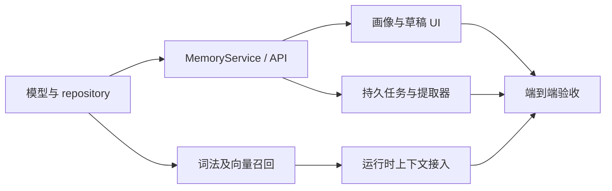

# OnCallAgent 长期记忆开发与验收

版本 v0.3，更新于 2026-11-09。M1–M4 已完成阶段验收。M4 的模型提取使用测试替身验收。

前置文档：[长期记忆架构](long-term-memory-architecture.md)。恢复完整路线，分阶段交付；不用一次性接入三个记忆框架。先完成并展示文档，再按既有文档评审约定进入代码阶段。

## 1. 开发约束与完成定义

1. 保留当前工作区未提交修改，不 reset、不批量格式化、不清空数据库、不替换登录页、不改已有父子召回语义。
2. 首次开发前记录准确分支、Git 状态、依赖版本和数据路径。已有 `docs/login-review.md` 的 157 项 Python / 15 项 JS 为上轮记录，不能当作新阶段已运行结果。
3. 按阶段增加功能开关；默认关闭记忆与真实模型调用。离线测试允许运行，真实付费调用需另行明确开启与预算。
4. 新增配置同步 `.env.example` 与本机 `.env` 缺失键，保留原有值，不输出密钥。
5. 记忆 API 只接受后端验证身份；用户输入、模型输出和 cookie 中的未验证字符串均不得决定归属。
6. 每阶段完成后记录文件、测试命令与结果、剩余限制。未要求时不提交、不推送、不更改用户服务启动方式。
7. 完整第二阶段完成的判据：画像、事故草稿/确认、撤回/遗忘、跨会话召回、可靠提取任务、管理 UI、失败降级及隔离回归全部完成；完成前不得写“完整长期记忆已交付”。

## 2. 文件与模块规划

以下是拟新增／拟修改清单，不代表这些文件已经实现。

| 文件 | 职责 |
| --- | --- |
| `app/models/memory.py` | ProfilePatch、IncidentDraft、IncidentConfirm、MemoryRunContext、RecallResult、任务状态及 API 请求/响应 schema |
| `app/storage/memory_db.py` | 共享 SQLite 连接、版本迁移、备份及画像的归属与 CAS。复用会话 DB 路径 |
| `app/storage/memory_incidents.py` | 事故归属、状态迁移、会话删除钩子、词法检索及向量索引任务的事务写入 |
| `app/storage/memory_incident_index.py` | 版本化词法规范化、FTS5 索引写入与安全 MATCH 表达式 |
| `app/services/memory_service.py` | 对外领域入口，协调读写、提案确认、召回、遗忘；不持有全局用户身份 |
| `app/services/memory_retrieval_service.py` | 词法查询、环境过滤、向量分支、RRF、回表复核、裁剪与降级 |
| `app/services/memory_vector_store.py` | 独立记忆 Milvus 集合的 schema、显式超时、确定性 ID、upsert/delete、关闭与重建 |
| `app/services/memory_extraction_service.py` | 有界来源提取、脱敏、候选门控、结构化模型输出及白名单提案；不直接改 confirmed 记录 |
| `app/services/memory_prompts.py` | 固定记忆使用规则、提取 prompt、渲染器；记忆数据不能变成自由格式 system 指令 |
| `app/services/memory_worker.py` | lifespan 管理的 SQLite 任务消费者、lease、退避、取消与停机 |
| `app/agent/memory_context_middleware.py` | RAG 模型调用视图注入；不修改持久 messages，不重复检索 |
| `app/api/memory.py` | 当前用户记忆 CRUD、提取/任务状态、确认/撤回、遗忘 API |
| `app/config.py` / `.env.example` / `.env` | 开关、预算、检索/提取上限及集合配置 |
| `app/storage/session_db.py` | 最终消息 ID 获取、记忆任务同事务入队、会话删除钩子；现有 CRUD 保持兼容 |
| `app/api/chat.py` / `app/api/aiops.py` | 路由后构建 MemoryRunContext，统一完成事件与候选入队，SSE 扩展 |
| `app/services/rag_agent_service.py` | context_schema / middleware 接入，普通与流式一致 |
| `app/services/aiops_service.py` / `app/agent/aiops/*.py` | Runtime 上下文传递到 planner/executor/replanner，不改变规划图边或历史状态语义 |
| `app/main.py` | 路由注册、记忆初始化和 worker 关闭；不额外启动进程 |
| `static/index.html` / `static/app.js` / `static/styles.css` | 后续新增记忆 dialog 和入口，复用现有风格与 authFetch，不改登录页风格 |
| `tests/test_memory_*.py` / `tests/memory-ui.test.cjs` | 分层回归；模型/向量均有可注入替身 |

避免过度拆分：职责少的 prompt/normalizer 可先放在对应模块；只有出现真实共用或单独测试需要时再独立文件。不要为每个记忆类型另写一套 Agent、LLM 客户端或登录系统。



## 3. 分阶段开发与验收

### M1：画像基础与用户隔离（已完成）

实际实现、边界、测试与截图见 [M1 验收记录](memory-m1-acceptance.md)。M1 仅开放手动管理与 use_enabled；auto_extract_enabled 只读，模型上下文接入仍属于 M3。

交付：空画像、白名单编辑、版本冲突、暂停使用、删除画像字段；记忆中心先展示画像 Tab。创建 ltm_profiles/ltm_audit 及 migration 元数据；不调用模型、不连接新向量集合。

开发顺序：

1. schema 定义字段上限、可空规则、服务名列表去重、revision/generation。
2. repository 实现 lazy create 和 owner 限定更新；空 PATCH 与字段删除语义固定，额外字段拒绝。
3. API 接入 CurrentUser，profile 修改接受 expected_revision；不接受 user_id。
4. UI 复用当前 dialog：加载、编辑、保存中、保存成功、409 重载提示、401 返回登录。

验收：Alice 编辑不改变 Bob；Admin 不能读取 Alice；空画像可保存；并发编辑只有一个成功；临时环境声明不写长期设置；重建 repository 后值保留；未授权无副作用。

### M2：事故草稿、确认与索引权威性

交付：手动创建、分页查看、修改、确认、失效、撤回事故；词法索引；本阶段不依赖真实提取模型。创建 ltm_incidents、ltm_incidents_fts 和索引任务所需 ltm_jobs。

开发顺序：

1. 实现事件状态机和 outcome；resolved 必须提供恢复证据引用与用户显式确认。
2. 编辑 confirmed 记录退回 draft，旧索引立即不再有效；API 返回新 revision。
3. 同一 SQLite 事务完成确认＋FTS 更新＋向量索引任务入队；先允许 vector 功能关闭。
4. 实现撤回清正文、同事务移除 FTS、索引清理任务；不能让模型直接 DELETE。
5. source_session 归属验证；引用不存在消息、未来消息或其他用户证据均拒绝。
6. 会话删除钩子同事务取消来源任务、撤回来源事故；画像为独立设置，UI 明确提示。

验收要求覆盖草稿、失效、撤回及过期事故的检索过滤，确认后修改需再次确认，来源越权与旧版本更新需被拒绝。删除来源会话同步撤回关联事故。同症状的不同事故独立保留。

#### M2 实现契约

- 在「长期记忆 → 事故经验」创建草稿。标题必填。确认前还需填写症状、目标服务、适用环境和发生时间。根因未知时可留空。确认「已恢复」需要证据摘要，以及用户填写的 HTTP(S) 参考链接或属于来源会话的消息编号。服务端校验会话与消息的归属、引用范围和时间。链接作为用户提交的引用保存。
- 事故正文位于详情的 `incident` 字段。新增事故从 revision 1 开始，事实修改退回 draft，空修改保留版本。失效保留正文供修订，撤回仅保留状态、标识、版本、generation 和撤回时间。列表按创建顺序倒序返回，`next_cursor` 为空表示末页。
- `GET /api/memory/incidents/search` 支持 `q`、`limit`、`environment`、`cluster`、`namespace`。normalizer v1 使用 NFKC 和大小写归一化，中文采用相邻字符二元组，服务名和错误码等含标点的字面量作为完整 token。FTS5 使用 BM25 排序。搜索在 LIMIT 前复核归属、状态、版本、generation、有效期和指定环境。FTS5 缺失时显示 degraded 并使用显式标识符精确匹配。[SQLite FTS5](https://sqlite.org/fts5.html)
- 选择来源会话后可查看最近 50 条消息编号和短预览。会话删除与关联事故撤回、索引清理及待处理任务失效共用原会话事务。向量索引和清理任务随事务落库，消费者及聊天召回安排在后续里程碑。
- 首次进入事故页时应用迁移 v2，先备份 SQLite，再增加事故、索引任务和可用的 FTS5 表。M1 画像与历史会话保留。管理功能无需开启 `LTM_ENABLED`。

### M3：召回与本轮模型上下文

交付：画像跨会话生效、词法/向量可选召回、RAG/AIOps 统一运行时上下文、普通聊天偏好，以及 SSE 依据徽章。创建 usage 预留能力后才允许真实 embedding。

开发顺序：

1. 复用 M2 已探测并验收的 FTS5 和 normalizer v1。
2. 将 M2 的参数化词法查询接入运行时，并继续复用精确标识符和中文片段算法。
3. 实现 independent Milvus store；测试使用假客户端，真实服务器版本只读探测；显式 schema 校验、维度检查、稳定 vector ID、超时和连接关闭。
4. query embedding 复用配置与 provider 工厂；schema 标识包括模型、维度、normalizer。更换模型不覆盖原知识库集合。
5. 两路候选按 owner/状态/环境筛选后排名合并，统一回表校验 revision、generation、content_hash、expires_at；过滤必须在各路 limit 之前生效。
6. MemoryRunContext 由 API/MemoryService 构建，读一次后供图内多步使用。用本地已安装的 context_schema/Runtime/ModelRequest.override 接口接入，不传可由模型改写的身份参数。
7. 中间件在模型调用视图中注入参考；反复请求或 checkpoint 重建不累加历史记忆块；不能让 compactor 把已注入记忆再抽取一遍。
8. query/query_stream/execute/diagnose 与 general_chat 路径均覆盖，不只接页面最常见的一条路。
9. SSE 增加 memory_recall 元数据；保留原 route/content/done/error 与 AIOps 事件契约。

验收：更正画像后新会话和下一轮均使用新值；本轮指定目标覆盖默认；两个用户同问题不串；不同生产环境不能混用；历史排除假设不成为强制禁查；旧向量版本不能注入；字数预算保留关键适用条件；未启用 paid_calls 不调用 embedding；记忆故障保留原对话回答。

#### M3 使用与验收

1. 在本地 `.env` 设置 `LTM_ENABLED=true`，重启 OnCallAgent 后刷新网页。在「长期记忆 → 个人画像」勾选「允许在聊天中使用长期记忆」。可保存默认环境，或在本轮明确写出环境。普通聊天参考语言、详细度和自然语言回答偏好。
2. 事故召回要求有效环境，已明确的集群和命名空间也参与精确过滤。明确变更目标时移除与旧目标关联的默认值。范围歧义时跳过事故。调用方也可在 Chat 请求中传 `memory_scope`，例如 `{"environment":"staging","namespace":"pay-stage"}`。独立 AIOps 请求提供 `symptoms` 才会搜索事故，空输入继续全量诊断并参考可用画像。
3. 默认使用 SQLite 词法索引。需要试用混合召回时，为本地配置同时开启 `LTM_VECTOR_ENABLED` 和 `LTM_PAID_CALLS_ENABLED`，设置正的 `LTM_DAILY_EMBEDDING_ITEM_BUDGET`。embedding 按 UTC 日对应用共享额度，在发出调用前预留，失败或结果未知的调用保守计入额度。
4. 显式同步向量时执行 `./.venv/Scripts/python.exe -X utf8 -m app.services.memory_vector_store --user-id sre_alice`。命令仅同步已启用长期记忆账号的有效确认事故，并按版本生成稳定向量 ID。更换 embedding 模型或维度时配置新的集合名。M2 的 outbox 自动消费和向量物理清理属于后续后台任务。SQLite 回表复核归属、状态、版本、generation 和内容哈希，拒绝旧向量。
5. SSE 的 `memory_recall` 与快速对话响应的 `data.memory` 只返回状态、画像版本、事故标题与版本等展示字段。当前轮次的参考 JSON 只用于模型调用视图。原始参考块不进入 SQLite checkpoint、知识检索工具输入或聊天历史。使用私有参考的模型与图调用关闭远程 LangSmith 跟踪。
6. 以下命令复现 M3 验收。pytest 和 Chrome 使用临时 SQLite 与测试模型。

```powershell
.\.venv\Scripts\python.exe -X utf8 -m pytest tests -o addopts="" -q
node --test tests/session-ui.test.cjs tests/memory-ui.test.cjs
.\.venv\Scripts\python.exe -X utf8 tests/headless_memory_smoke.py --m3
```

优先观察同一个问题在 Alice 和 Bob 下的徽章差异、临时切换环境、同会话修改画像和撤回后下一轮、以及关闭个人开关后原聊天行为。真实 Milvus 协议已使用合成向量验证。线上 embedding 的召回效果与延迟另行评估。[Milvus 过滤检索](https://milvus.io/api-reference/pymilvus/v2.6.x/MilvusClient/Vector/search.md)

### M4：可靠后台提取与完整管理闭环

交付：自然语言画像建议、从当前会话生成复盘草稿、可恢复后台任务、任务状态 Tab、遗忘全部和预算统计。

开发顺序：

1. 聊天最终消息持久化路径返回 message_id；在同一事务进行候选门控与幂等任务 INSERT。不得先对前端发“记住成功”再写入任务。
2. 完整回复正常结束才调度自动事故草稿；失败/取消保持原用户消息语义，不追加伪成功记录。
3. worker 短事务领取任务：pending 或过期 lease、符合 next_attempt_at；原子变更 running 并设置 lease。默认一个消费者、并发 1，lease 初始 60s，可在模型调用期间续租。
4. 提取前复核 owner、来源消息范围与 generation，校验输入长度并脱敏；模型输出仅是 Pydantic 提案。
5. 预算事务预留成功才发请求；max_retries=0；任务层最多重试一次，鉴权/配额/结构错误不盲目重试。
6. 模型返回后重验 generation/source/revision，并将结果与 succeeded 或 needs-review 语义提交到任务 result。对外任务状态可为 succeeded＋requires_confirmation=true，不新增相互矛盾的状态枚举。
7. 用户审阅字段差异后，通过现有 PATCH/confirm API 应用。显式 NOOP 不重复写记忆；不同轮次不能只靠症状文本哈希去重。
8. 遗忘全部、来源删除、旧任务重放都使用 generation/revision 防复活；删除后清空 payload/result 中的敏感正文。
9. lifespan 关闭停止领取、发出停止信号、等待有界任务；重启恢复过期 lease。不能因为 auto-reload 把旧提取结果写给另一个登录账号。
10. UI 轮询仅当前用户选中的任务，关闭 dialog 或切换身份时停止；沿用已有 authVersion/AbortController 隔离策略。

验收：进程在领取后退出、模型返回前遗忘、确认后索引失败、旧源会话删除、重复入队、预算耗尽、停机重启、非法提取输出均有确定结果。用户必须能看到待确认与真正保存的区别。

### M4 实现约定

任务用 SQLite 事务和领取凭证保护。自动任务与最终回复共用事务，手动提取通过会话和已完成消息范围建任务。画像建议展示字段级来源与差异，审核时在同一事务中复核来源、代号和画像版本。事故提议通过审核后进入草稿，随后沿用事故确认流程。后台索引继续消费 M2 的 outbox，向量未配置时保留待处理状态，撤回后的读路径立即以 SQLite 为准。

`GET /api/memory/jobs` 列出当前账号任务与日额度，`POST /api/memory/jobs/{id}/review` 提交审核。预算不足、暂时失败或领取超时的终态任务可通过 `POST /api/memory/jobs/{id}/retry` 显式重试。向量清理独立于付费调用开关，在向量存储启用时执行。记忆使用、自动提取和付费调用保持显式开启，额度由部署者填写。历史聊天、备份、当前请求各有自己的保留范围。

启用步骤为在 `.env` 设置 `LTM_ENABLED=true`、`LTM_PAID_CALLS_ENABLED=true` 和正数的提取日额度。输出日额度须至少覆盖一次 `LTM_EXTRACT_OUTPUT_TOKENS`，输入日额度按消息、提示词和结构化输出 schema 的保守估算预留。启用自动提取还需设置 `LTM_AUTO_EXTRACT_ENABLED=true`，在个人画像勾选「允许从完成的对话生成待审核建议」。手动提取在「任务状态」选择来源会话。自动向量索引还需启用向量开关和 embedding 日额度。生产调用由现有兼容接口执行，脱敏规则处理常见凭据格式，提取范围由消息窗口限制。

M4 回归用例覆盖独立 SQLite、假模型、领取过期恢复、预算拒绝、引用校验、来源删除、索引失败回退、遗忘与迟到结果。浏览器用例以测试模型验证审核、草稿、遗忘和换账号。运行命令如下。

```powershell
.\.venv\Scripts\python.exe -X utf8 -m pytest tests -o addopts="" -q
node --test tests/session-ui.test.cjs tests/memory-ui.test.cjs
.\.venv\Scripts\python.exe -X utf8 tests/headless_memory_smoke.py --m4
```

## 4. API 与领域契约

### 自然语言回答偏好

- `GET/PATCH /api/memory/profile` 的 `profile` 与 `changes` 新增可选 `response_preferences`。仍按 `user_id` 主键读写原表。旧记录与已有待审任务兼容。手动保存以每行一条的文本框整体提交此字段，最多 50 条，每条最多 500 字符。空列表或 `null` 清除该字段，去重并保留顺序。
- 自动提取将结构化变化和自然语言变更分开。每条自然语言变更带 `previous`、`text` 及用户原话出处，服务端校验旧值、增改内容来自原话、删除意图明确，再合并为待审核的列表差异。审核页可独立勾选自然语言列表或结构化字段，沿用版本、账号和遗忘代号校验。提取详细度时要求明确的详略证据。
- 读路径在普通聊天、RAG 与 AIOps 的本轮画像参考中加入已确认条目。沿用全局开关、账号开关和整体上下文预算。预算不足时保留列表开头能装下的完整条目，避免截断语义。临时偏好只随本轮请求，不触发画像写入。
- 验收覆盖手动增改删与旧画像兼容、自动提议前后读路径、跨会话和跨账号、临时要求、审核冲突、遗忘旧任务、浏览器编辑与审核，并检查 SQLite 的查询计划和本地画像读取耗时。

API 全部走 /api/memory，使用 CurrentUser，JSON 无 user_id/namespace SQL 过滤表达式。未知字段拒绝，正文长度有上限。正常响应沿用 code/message/data；列表分页 limit 初始 20、上限 100。

| 方法／路径 | 请求要点 | 结果 |
| --- | --- | --- |
| GET /profile | 无 owner 参数 | 当前 profile、revision、generation、use_enabled/auto_extract_enabled |
| PATCH /profile | expected_revision、仅白名单 changes、可选 use_enabled/auto_extract_enabled | 保存后的 profile 与 revision；409 不自动覆盖 |
| GET /incidents | status、limit、cursor | 当前用户分页结果；不返回其他用户数量 |
| POST /incidents | 允许字段与证据、可选 source_session_id/source_message_ids | 新 draft，201 |
| GET /incidents/search | q、limit、environment、cluster、namespace | 当前用户有效 confirmed 事故、lexical_mode |
| POST /incidents/from-session | session_id、消息范围、request_id | 当前用户 job，202；paid 不可用时 409，不假装排队成功 |
| GET /incidents/{id} | 路径 ID | 当前用户可见记录；不存在/越权 404 |
| PATCH /incidents/{id} | expected_revision、changes | 新 revision，事实编辑退回 draft |
| POST /incidents/{id}/confirm | expected_revision、outcome、恢复证据/适用条件 | confirmed 与索引状态 |
| POST /incidents/{id}/invalidate | expected_revision、reason | invalidated；立即禁止召回 |
| DELETE /incidents/{id} | expected_revision 作为 query 参数 | withdrawn，清正文与索引清理已入队 |
| GET /jobs | limit、cursor | 当前账号的任务与今日用量 |
| GET /jobs/{id} | 路径 ID | status、requires_confirmation、结果提案、脱敏错误、可重试标记 |
| POST /jobs/{id}/review | action、可选 fields | 应用所选画像字段、保存事故草稿或忽略建议 |
| POST /jobs/{id}/retry | 路径 ID | 显式重试可恢复的失败任务，202 |
| POST /forget | expected_generation、confirm=true | 新 generation；旧任务失效 |

画像 changes 示例（只示意契约，不在本轮发送）：

```json
{
  "expected_revision": 3,
  "changes": {
    "answer_detail": "concise",
    "default_cluster": "cluster-a",
    "default_environment": "production",
    "default_namespace": "prod-pay"
  }
}
```

changes 中显式 null 删除可空字段；未出现字段保持不变。responsible_services 是去重列表的整体替换，模型建议必须经用户确认后才能发送该 PATCH；不能用新数组悄然删除旧服务。

MemoryRunContext 仅含可信身份、请求/会话 ID、scope、profile revision/generation、有界 profile/episode 参考和 recall 状态，不包含密码、JWT 或全量工具轨迹。confirmed 事故标题/ID/适用环境属于证据展示，不是模型内部推理。

## 5. SQLite 迁移、并发与备份

- memory repository 接受 db_path 或已打开连接；复用 SessionDatabaseManager 的绝对默认路径，测试必须传临时路径。
- schema migration 记录在独立 ltm_schema_migrations(version PRIMARY KEY, applied_at) 中；每个版本只执行一次，初始化幂等。此元数据表不计入架构图五张业务表。
- 迁移只新增本阶段所需表/索引；旧 users/password/JWT/checkpoint 无数据转换；已有用户默认没有任何长期记忆。
- 在迁移前使用 sqlite3.Connection.backup 生成带时间戳的本地备份，验证可打开和表清单；不要打印密码哈希或 app_secrets 的值。
- 多表更新使用同一连接短事务，必要时 BEGIN IMMEDIATE；CAS WHERE owner AND revision；模型、embedding 和 Milvus 调用绝不放在写事务中。
- FTS 和 SQL 内容更新同事务；Milvus 使用 outbox 类型任务，最终一致；必须支持按所有当前 confirmed revision 重建记忆索引。
- 不能直接在 __init__ 里连接模型或创建外部集合；LTM_ENABLED=false 时现有启动行为不变。
- 代码回退先关闭功能开关即可；新表保留，不自动 DROP。恢复备份会覆盖之后的新会话，必须由用户明确选择，不能作为常规自动回滚。

## 6. 初始配置清单

M3 已配置记忆总开关、向量与付费调用开关、集合名、embedding 日额度和召回参数。其余参数随 M4 接入。

| 配置 | 初始值 | 含义 |
| --- | --- | --- |
| LTM_ENABLED | false | 记忆总开关 |
| LTM_AUTO_EXTRACT_ENABLED | false | 自动提取总开关；还受用户设置限制 |
| LTM_PAID_CALLS_ENABLED | false | 真实 LLM/embedding 调用总开关 |
| LTM_VECTOR_ENABLED | false | 向量检索/索引分支 |
| LTM_COLLECTION_NAME | oncall_long_term_incidents | 独立集合，不覆盖原知识库 |
| LTM_EXTRACT_MODEL | qwen3.8-flash | 候选提取模型；需验证平台结构化输出与关闭思考参数 |
| LTM_RECALL_TOP_K | 3 | 最终事故数量，不是已测最优 |
| LTM_CANDIDATES_PER_ROUTE | 10 | 两路各自 owner/状态过滤后的候选上限 |
| LTM_CONTEXT_ESTIMATED_TOKENS | 32768 | 模型参考内容总预算，使用估算 token |
| LTM_RECALL_TIMEOUT_SECONDS | 2 | 整体记忆召回超时，超时走本地降级 |
| LTM_EXTRACT_TIMEOUT_SECONDS | 15 | 提取客户端请求超时 |
| LTM_WORKER_CONCURRENCY | 1 | 本地后台并发数 |
| LTM_JOB_LEASE_SECONDS | 60 | 必须大于单次客户端 timeout 并留提交余量 |
| LTM_JOB_MAX_ATTEMPTS | 2 | 总尝试次数，含首次；应用层统一重试 |
| LTM_DAILY_INPUT_TOKEN_BUDGET | 0 | 未设置正额度则拒绝真实提取 |
| LTM_DAILY_OUTPUT_TOKEN_BUDGET | 0 | 同上；每次调用还受输出上限约束 |
| LTM_DAILY_EMBEDDING_ITEM_BUDGET | 0 | 未设置正额度则拒绝真实 query/index embedding |

复用 QWEN_API_KEY/QWEN_API_BASE 和 embedding 模型/维度；不增加明文密钥字段。不要从 MemoryService 全局改 Agent 的 enable_thinking；关闭思考仅用于兼容且已验证的提取请求。

初始提取输入上限 6,000 字符、输出上限 1,000 token；确切值可在小样本评估后调整。输入超限优先选择明确范围，不静默丢失恢复证据。费用账本区分预留、成功、失败和结果未知；客户端重试=0，任务 retry 每次单独预留。embedding item 额度需搭配单条长度上限，不等价于人民币硬预算。未配置平台单价前不提供虚构成本金额。

### 长上下文配置审计

800 个估算 token 是 M3 的首版配置。预算作用于画像、事故参考及其使用规则。当前调大独立记忆预算和各链路的历史窗口，仍按相关性和环境确定进入本轮的内容。预算是上限，发送长度取决于实际命中的内容。

| 链路 | 原限制 | 调整 |
| --- | --- | --- |
| 长期记忆注入 | 总预算 800，配置上限 4,000，画像单独最多约 200，事故参考字段先截到 180 字符，最终最多 2 条 | 默认 32,768 个估算 token，支持配到 1,000,000。画像与事故使用同一预算。默认最终最多 3 条、每路候选仍为 10。保留完整症状、根因、恢复观察和复盘结论，超预算优先省略次要字段或少带案例 |
| 事故词法检索 | 超过 8,000 字符跳过环境解析，查询只取开头 1,000 字符，FTS 只取前 64 个词项 | 环境解析覆盖完整问题。词法查询最多 16,000 字符，长输入保留首尾。FTS 最多 128 个词项，兼顾首尾关键词 |
| 聊天和独立 AIOps 输入 | 网页 1,000 字符且为单行输入，AIOps 症状最多 1,000 字符 | 网页输入支持多行，沿用原高度和发送键，去除字符上限。AIOps 症状允许 64,000 字符 |
| 普通聊天历史 | 最近 40 条消息 | 按可配 token 窗口读取最近完整消息。默认 64,000 个估算 token，当前长上下文部署用 128,000 |
| RAG 查询改写历史 | 6 条、共 6,000 字符，外部知识查询历史单条最多 4,000 字符 | 默认 20 条、共 32,000 字符，知识接口允许较长历史。知识检索查询仍限 4,000 字符，发给检索模型的查询和整个聊天输入是两份数据 |
| RAG 会话压缩 | 高水位 48,000、目标 18,000，历史工具输出 45,000 字符开始剪枝 | 当前长上下文部署使用 256,000、160,000 和 96,000。同步和异步路径按目标水位保留完整轮次。示例配置说明对应设置，通用代码默认保留原水位以兼容较短窗口的模型 |
| AIOps 复判 | 每步结果 4,000 字符 | 可配，默认 24,000 字符。终稿继续使用完整执行历史 |

保留单独的 embedding 请求上限 1,000 字符，长查询取首尾片段。知识库实际父子分块为 1,600 / 400 字符，子块重叠 80。示例文件中的旧 CHUNK_MAX_SIZE=800 未被当前配置读取。保留 Supervisor 的 256 token 分类输出、改写与 HyDE 的 512 token 输出、AIOps 执行步数、2 秒记忆召回回退、知识库召回条数和分块尺寸。会话压缩送入独立提炼模型前的每条 3,000 字符和规则摘要的展示上限也保留。它们分别控制分类/检索子任务、工具循环、响应等待和索引行为。变更知识库分块需要重建索引。事故表单的 2,400 字符是单个摘要字段上限，完整长日志可通过消息证据引用。账号归属、环境过滤、预算授权、上传大小、管理页预览/分页仍各自独立。M4 的 6,000 字符提取输入与 1,000 token 输出是独立提取任务的设计初值，按所选模型和实际样本再校准。

## 7. 测试计划

| 测试文件（拟新增） | 核心断言 |
| --- | --- |
| test_memory_storage.py | 空库、幂等迁移、旧库升级、随机用户隔离、CAS、来源删除、字段清空 |
| test_memory_policy.py | 临时/否定/他人事实不晋级，白名单、证据状态、错误 resolved、历史 dead ends 不禁查 |
| test_memory_retrieval.py | FTS 字面量/中文片段、不同环境、RRF、空命中、过期、旧版本、预算、向量超时和词法降级 |
| test_memory_runtime.py | 真 LangGraph＋假模型，覆盖两轮/新会话画像、RAG/AIOps 运行时上下文、checkpoint、环境覆盖、向量旧版本和超时降级 |
| test_memory_vector_store.py | 假 Milvus 和假 embedding，覆盖独立 schema、标量过滤、预算、连接关闭及手动索引 |
| test_memory_jobs.py | 幂等、短事务领取、lease 恢复、预算预留、失败退避、遗忘/删除竞态、旧 generation 不回写 |
| test_memory_api.py | 匿名401、冒用ID404、额外owner参数拒绝、确认/撤回/分页、source session越权、revision冲突 |
| test_memory_integration.py | 完整应用＋临时 SQLite＋外部替身；普通/SSE/独立AIOps；重启两进程恢复任务和记忆 |
| memory-ui.test.cjs | 空列表、保存/409、确认、取消、401、快速切换账户、旧响应、job轮询停止、遗忘、原登录行为不回归 |

测试继续使用 tests/conftest.py 禁止真实 HTTP 和远程 trace。模型/embedding/Milvus 均注入替身；不能为了让测试通过解除网络拦截。真实客户端协议通过 MockTransport 核对，但协议测试不等于平台实测。

测试命令（对应文件开发后执行）：

```powershell
.\.venv\Scripts\python.exe -X utf8 -m pytest tests -o addopts="" -q
node --test tests/session-ui.test.cjs tests/memory-ui.test.cjs
node --check static/app.js
git diff --check
```

不按测试数量判断功能效果：验收记录必须区分离线假模型、真实本地 HTTP、真实模型/embedding、真实 Milvus 和浏览器截图。

## 8. 人工场景与效果评估

先离线，再在明确授权的调用预算内做小样本；所有预设事故都标记 synthetic，不能冒充真实线上复盘。

| 场景 | 操作 | 预期 |
| --- | --- | --- |
| 画像跨会话 | Alice 保存 concise/prod-pay，新建会话 | 下一轮参考正确；不是默认获得生产权限 |
| 临时覆盖 | 当前问题指定 staging | 本轮使用 staging，长期 prod-pay 不变 |
| 画像纠正 | 改默认 namespace 或清空服务列表 | 下一轮不使用旧值；revision递增 |
| 用户隔离 | Bob 提同样问题或使用 Alice memory/job ID | 看不到 Alice 私有内容 |
| 草稿质量 | 只说“可能连接池泄漏”，生成复盘 | 保持 draft / unknown，不自动确认根因 |
| 历史事故复用 | 确认带环境和恢复证据的案例，新会话问相似问题 | 展示案例引用并验证当前证据，不自动执行旧命令 |
| 事故纠正 | 确认后改根因或标记失效 | 旧 revision 不再召回 |
| 删除竞态 | 提取中删除来源会话或遗忘全部 | 旧任务结束也不产生可用新记忆 |
| 进程恢复 | 任务 running 后退出测试进程，启动新进程 | lease到期后恢复，不重复写 confirmed |
| 检索降级 | 向量超时/不可达 | 词法或仅画像继续，回答不失败，前端不伪称混合命中 |
| 超额停止 | 日额度不足或paid关闭 | 外部调用次数为0，任务/界面说明原因 |

对照关闭记忆／仅画像／画像＋词法／画像＋混合；保留输入、标注记忆 ID、实际选中 ID/revision、是否误用、模型实际调用/token、召回及首 token 延迟。分别报告写入质量、召回质量和最终回答效果，不用单一“准确率”合并。

先验证记忆纠正、隔离、删除和可靠性；这些检查失败时停止真实效果实验。没有受控对照前不写“节省20分钟”“10秒定位”或“性能提升百分比”。

## 9. 开发启动前检查与阶段交付

开发前：审阅架构图、字段与删除语义、用户私有范围和四阶段顺序；确认使用现有 Milvus 独立集合、FTS词法基线、人工确认事故以及默认不调用付费模型。

每阶段交付记录：

- 本次实现文件及接口；新增字段/迁移版本；是否实际操作业务数据库。
- 测试名称、命令、通过/失败数量与运行日期；失败是否修复；外部替身范围。
- UI是否复用原样式、是否真实浏览器验证；不能把DOM逻辑测试写成视觉验收。
- 本阶段开启了哪些开关；真实付费调用数（若有）；剩余限制。
- 下一阶段唯一入口；不提前塞入团队共享、图记忆或自动执行修复。

M1–M4 已通过阶段验收。[M1 验收记录](memory-m1-acceptance.md)

M2 于 2026-11-08 通过以下验证。Python 测试报告 4 条既有 Pydantic 弃用警告。浏览器使用临时应用与 SQLite，业务数据库的迁移会在使用事故管理功能时触发。

| 命令 | 结果 |
| --- | --- |
| `./.venv/Scripts/python.exe -X utf8 -m pytest tests -o addopts= -q --tb=short` | 192 项通过，覆盖事故状态流转、归属与来源、事务回滚、词法降级及删除竞态 |
| `node --test tests/session-ui.test.cjs tests/memory-ui.test.cjs` | 25 项通过，覆盖会话、鉴权与画像 |
| `./.venv/Scripts/python.exe -X utf8 tests/headless_memory_smoke.py --m2` | `BROWSER_M2_OK`，覆盖草稿、证据、确认、搜索、版本冲突、撤回、390px 布局及 Alice/Bob 隔离 |

M3 于 2026-11-08 通过以下验证。测试画像、会话和事故写入临时 SQLite。浏览器启动独立 Chrome 与临时 OnCallAgent 实例，模型、MCP 和 Supervisor 路由采用测试替身。

| 检查 | 结果 |
| --- | --- |
| Python 全量 pytest | 200 项通过，4 条既有 Pydantic 弃用警告 |
| Node 会话与记忆回归 | 26 项通过 |
| Chrome 浏览器 M3 | `BROWSER_M3_OK`。两个不同会话均把同一画像传入测试模型，覆盖流式和快速模式。Alice/Bob 同题各自召回，撤回事故后管理页搜索无命中，原会话下一轮只参考画像，Bob 仍能召回自己的事故 |
| Docker Milvus 2.5.10 | `MILVUS_M3_OK`。使用合成向量验证建表、重复同步、并发账号隔离和撤回后 SQLite 拒绝旧向量。临时集合已清理 |

验收期间修复了事故仓库类型注解导致的导入错误，并让并发会话测试替身接受 M3 的参数。真实 Milvus 验收发现客户端可能共用底层连接，默认读一致性也可能暂时看不到刚写入的向量。为每个短生命周期客户端指定独立连接别名，向量查重与搜索使用强一致读取。复测确认关闭连接不影响并发请求，重复同步不再重新嵌入已写入的事故。验收未调用真实千问模型或 embedding 服务。[PyMilvus 连接管理](https://github.com/milvus-io/pymilvus/blob/master/examples/manage_milvus_client/how_to_manage_milvus_client.md) · [Milvus 2.5 一致性](https://milvus.io/docs/v2.5.x/consistency.md)


### M4 验收记录

2026-11-09 使用临时 SQLite、临时 OnCallAgent 实例和独立 Chrome 配置完成验收。模型、Milvus 和 MCP 在本轮应用测试中均使用替身。

| 检查 | 结果 |
| --- | --- |
| Python 全量 pytest | 211 项通过，4 条既有 Pydantic 弃用警告 |
| Node 会话与记忆回归 | 26 项通过 |
| Chrome M4 | `BROWSER_M4_OK`。自动提取的画像与事故先进入待审核。应用后画像才更新，事故才成为草稿。遗忘时将正在运行的测试提取器暂停到事务提交后，再让它返回有效结果。任务最终仍为已取消，旧提议不可审核，画像保持空白，Alice 的聊天记录仍可打开 |
| Chrome M2、M3 回归 | `BROWSER_M2_OK`、`BROWSER_M3_OK`。复验原有事故管理、跨会话召回和撤回链路 |

隔离场景同时为 Alice 和 Bob 准备任务、画像和事故。跨账号读取与审核返回 404。Alice 遗忘后，Bob 登录仍只显示自己的任务、画像和已确认事故。用例包括领取过期后的恢复、额度拦截、证据校验和索引失败时的词法召回。实际模型的提取质量、生产库迁移和 M4 在真实 Milvus 上的自动同步属于部署验收。

### 自然语言回答偏好验收

2026-11-09 全量 pytest 217 项、Node 27 项通过。Chrome 使用临时应用、SQLite 和测试模型验证手动编辑、提议审核、新会话引用、账号隔离，以及遗忘后旧任务无法写回。Python 验证已审核偏好进入普通聊天、RAG 和 AIOps 的模型参考，术语翻译原话不被映射为详细度。

本地 Windows 临时库包含 10,000 行合成画像。`EXPLAIN QUERY PLAN` 显示 `user_id` 主键索引点查。预热后连续 500 次调用 `read_runtime_profile`，包含连接、schema 检查、查表和 JSON 校验，中位数 3.4 毫秒，P95 5.2 毫秒。该数据对应本地串行画像读取，历史事故召回与模型响应时间单独计算。
