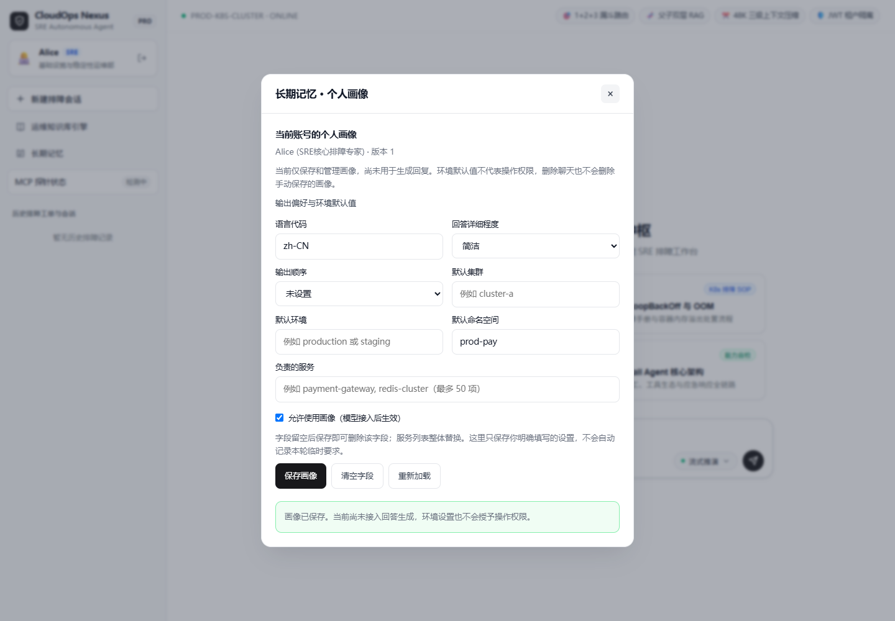
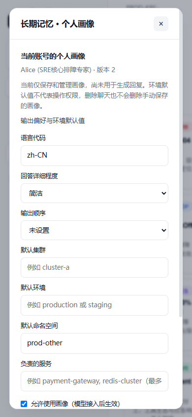

# M1 画像基础与用户隔离：交付与验收

日期：2026-10-24；阶段：**M1 完成**；M2/M3/M4 未开始。

本轮按 [开发文档](long-term-memory-development.md) 实现手动画像管理，保留当前 UI 风格。没有接入 Mem0、LangMem 或 Letta，没有新建 Milvus 集合，没有自动提取或调用模型，也没有修改既有检索、登录和聊天生成语义。

## 已实现

- 当前用户的空画像读取、白名单编辑、部分更新、清空字段和暂停使用设置。
- 7 个允许字段：语言代码、回答详细程度、输出顺序、默认集群、默认环境、默认 namespace、负责服务列表。
- `GET/PATCH /api/memory/profile` 仅使用已验证 JWT/Cookie 对应的 CurrentUser。拒绝额外 owner/user_id、查询参数和未知字段；不提供按用户 ID 读取其他画像的接口。Admin 没有额外读取权。
- `expected_revision` 乐观并发控制，冲突返回 409；前端保留本次输入并阻止继续覆盖，用户重新加载后才能保存。
- omitted 字段保持原值，显式 null 删除字段，空服务列表清空已保存列表，列表按原顺序去重。空 PATCH 和无实际变化的 PATCH 不增加 revision，也不写审计。
- 修改时画像、字段来源、revision、审计在同一短事务提交；审计只记录字段名和版本，不写画像正文、密钥或密码。
- 按需、幂等创建 `ltm_profiles`、`ltm_audit`、`ltm_schema_migrations` 三张表；未创建后续阶段的任务、事故、FTS 或 usage 表。
- 首次合法访问前通过 SQLite backup API 生成完整迁移备份，验证 quick_check/用户表后才执行迁移；备份无法完成则不迁移。备份保存在数据库同级 `backups/ltm-m1-*.db`，包含已有认证数据，应按私有数据库保管。
- 读取已存在的画像不触发写事务；SQLite 和备份操作经线程池执行，模块导入不进行 M1 迁移，不初始化模型或向量客户端。
- 现有侧栏新增“长期记忆”入口，复用知识库 dialog、按钮及主题变量；登录页和聊天布局没有重做。
- 保存中防重复提交，校验错误用中文反馈且保留输入；关闭弹窗、退出或身份变化后清空缓存，旧请求不能回填新账号。

## M1 的明确边界

**保存画像尚不会改变模型回答。** 将画像接入 RAG/AIOps/普通聊天的运行时上下文属于 M3；自动识别“记住”“这次临时”属于 M4。当前聊天不会自动改写画像，只有用户在画像表单中明确保存才生效到存储。

`LTM_ENABLED=false` 已同步加入 `.env.example` 和本机 `.env` 缺失配置，保留已有配置值。M1 管理接口仍可使用；该开关预留给后续运行时记忆使用，并不授予工具操作权限。

每个用户初始 `revision=0`、`generation=0`、`use_enabled=false`、`auto_extract_enabled=false`。M1 PATCH 只开放 `use_enabled` 设置；auto_extract_enabled 只读且不开放自然语言提取。开启“允许使用画像”只保存用户意愿，模型接入前不会改变回答；界面和 API 的 runtime_connected=false 均明确表达这一点。

画像是独立个人设置，删除聊天不会删除用户手动确认的画像。事故、遗忘全部与后台任务仍按后续阶段文档实现。

## 本轮执行结果

| 检查 | 结果 |
| --- | --- |
| 全项目 Python 回归 | **183 passed，44.13 秒**；4 条已有 Pydantic Config 弃用提示，无失败 |
| 前端逻辑回归 | **25 passed**，其中新增画像流程 10 项；其余 15 项验证已有登录/会话不回归 |
| M1 后端覆盖 | 新增 26 项断言场景/参数化测试实例，含实际完整应用路由；备份/迁移、空值/去重、CAS 两线程竞争、审计失败回滚、越权、未知字段拒绝、聊天临时声明不修改画像 |
| 真实浏览器验收 | 已安装 Chrome 的独立 headless 进程；真实 HTTP、DOM 和 CSS，临时应用、临时 SQLite、外部模型/Milvus/MCP 替身；输出 `BROWSER_M1_OK` |
| 浏览器具体操作 | 画像表单保存→读回；后台并发修改→UI 409 保留 staging 输入→重新加载获得新版本；390px 无横向溢出；切为 Bob 后读到空画像 |
| 代码检查 | node --check 和 git diff --check 通过 |
| 当前业务服务 | 127.0.0.1:9900 连接被拒绝，未把它宣称为已完成在线验收；本轮未启动/重启该服务 |
| 实际业务画像 | 未对当前用户画像写入测试值；浏览器写入和迁移均在临时数据库；首次真实访问会自动先备份再迁移 |

Python 回归继续拦截真实模型 HTTP 和远程 trace；浏览器验收也使用注入的外部服务替身，不消耗真实模型额度。没有安装依赖、没有提交或推送。

桌面 computer-use 工具因 WSL cwd URI 无法初始化，未通过该工具操作用户窗口；浏览器验收使用新的独立测试进程，结束后只关闭它自己创建的浏览器和临时服务。

## 截图

桌面 1440×1000：



390×844 窄屏（弹窗可纵向滚动）：



## 用户体验与复验

按原方式启动业务服务，Ctrl+F5 刷新后：登录 → 左侧“长期记忆” → 填写画像 → 保存；留空字段并保存即可删除。暂停时取消“允许使用画像”再保存。M1 只管理数据，不需要打开付费调用或新的外部服务。

PowerShell：

```powershell
.\.venv\Scripts\python.exe -X utf8 -m pytest tests -o addopts="" -q
node --test tests/session-ui.test.cjs tests/memory-ui.test.cjs
.\.venv\Scripts\python.exe -X utf8 tests/headless_memory_smoke.py
```

最后一条需要已安装 Chrome 或 Edge，以及当前虚拟环境中的 websockets；使用独立浏览器目录和临时 DB，不改用户现有浏览器配置，生成本页两张截图。

## 代码入口

- `app/models/memory.py`：白名单 schema、字段限制与请求契约。
- `app/storage/memory_db.py`：备份、迁移、归属、事务、审计与 CAS。
- `app/services/memory_service.py`、`app/api/memory.py`：当前用户画像领域入口和接口。
- `static/index.html`、`static/app.js`、`static/styles.css`：画像入口、编辑状态与沿用原主题的局部样式。
- `tests/test_memory_storage.py`、`tests/test_memory_api.py`、`tests/memory-ui.test.cjs`、`tests/headless_memory_smoke.py`：本阶段回归和真实浏览器验收。

后续从 M2 的事故草稿与确认继续，不自动进入 M3/M4，不宣称完整长期记忆已经完成。
