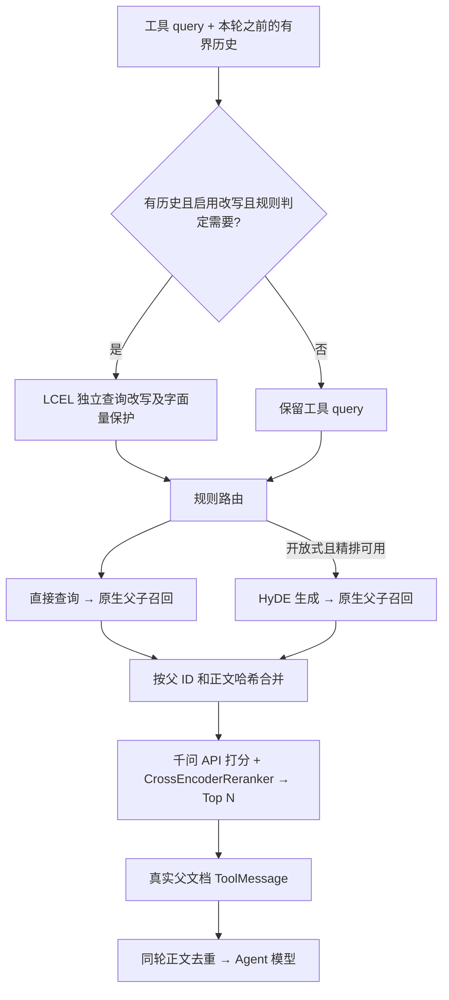

# 检索增强架构决策

日期：2026-10-20。基线：`8f127d7`；父子召回、同轮上下文去重已经由用户验证。
本文先于本轮代码改造建立。此前未提交的 MultiQuery 方案由本决策替代。

## 目标与非目标

目标是让对话中有指代的问题可以独立检索，并对部分开放式问题提供 HyDE 候选，
最终用千问 `qwen3.7-text-rerank` API 打分排序。所有证据仍来自已索引的真实父文档。
不把所有策略默认串联，不承诺召回率或毫秒级延迟；不替换已经验证的父子索引结构。
本阶段不引入 BM25、不把向量近邻距离直接解释成可信度，不增加第二套会话存储。

## 对外部建议的审查

| 建议 | 决策与修正 |
| --- | --- |
| 改写在 HyDE 前 | 需要消歧时成立；无历史、独立问题可以跳过改写。改写还包括查询扩展，不能将其定义局限为消歧。 |
| MultiQuery 可替代多轮改写 | 不采用。它默认只接收单条 question，不自动取得 Agent 历史；上一版只实现查询扩展。 |
| 原生 HyDE 无法定制或分支 | 不成立。当前安装源码支持 custom_prompt，可放在独立分支；不应替换共享 embedding 后再抱怨所有查询都触发。 |
| LCEL 是唯一正确方式 | 不成立。本项目选 LCEL 是为了显式输入输出、分流、回退和追踪；原生封装也可组合使用。 |
| Rerank 保证过滤 HyDE 幻觉 | 不成立。它只比较问题和真实候选的相关性，可能排序错误，不能认证事实或补救漏召回。 |
| 固定 200ms 改写、1s HyDE | 无实测依据。记录真实耗时和并发环境后再讨论。 |
| 多轮去重 | 已实现的是每个用户轮次内部的重复正文压缩，不跨用户轮次删除必要证据。 |

官方与本地源码核对：
[history-aware retriever](https://reference.langchain.com/python/langchain-classic/chains/history_aware_retriever/create_history_aware_retriever)、
[Cross-Encoder 集成](https://docs.langchain.com/oss/python/integrations/document_transformers/cross_encoder_reranker)、
[千问重排模型与协议](https://www.qianwenai.com/models/qwen3.7-text-rerank)。
当前实际 API 路径是 langchain_classic，不照搬旧版 langchain.chains 导入。

## 模块边界与数据契约

- Agent/LangGraph 继续控制是否调用工具。工具通过原生 ToolRuntime 读取当前图的消息，
  历史不由模型作为工具参数填写，也不在全局变量中保存。普通直接调用可不提供 runtime。
  快速/流式聊天有持久会话历史；AIOps planner 直接调用工具时无历史，executor 只提供它已有的
  步骤消息，不会凭空获得快速聊天记录。本阶段不改 AIOps 的历史与检查点设计。
- 从最新 HumanMessage 之前提取历史，保留有界的用户及最终助手文本；排除 SystemMessage、
  ToolMessage、带 tool_calls 的助手消息。历史只辅助消歧，不是检索证据。
- `KnowledgeRetrievalService` 是唯一编排入口，提供同步 retrieve 和异步 aretrieve；
  输入 query、可选 top_k（每路子块候选数）、chat_history，输出 List[Document]。
- LCEL 的 Prompt / MessagesPlaceholder / ChatModel / StrOutputParser 完成消歧和 HyDE。
  RunnableBranch 控制 HyDE，RunnableParallel 运行直接路和可选 HyDE 路。
  两条生成链显式通过 extra_body.enable_thinking=false 关闭当前千问模型的思考模式，
  temperature=0、输出预算 512 token；工厂不全局关闭 Agent 主回答的思考设置。
  这不是跨平台标准参数，也不能用于所有仅思考模型。空输出、截断及 API 不支持参数时仍走失败回退。
- 现有 ParentDocumentService 原样负责每路原生 ParentDocumentRetriever、版本过滤和父文档回取。
- 精排由原生 CrossEncoderReranker 排序与截断；千问 API 适配器只负责一次打分、
  分数校验与观测，不重新实现相关性算法。输入为独立问题和真实父文档正文。
- 工具仍返回 `(格式化正文, List[Document])`，框架包装为 ToolMessage.content/artifact。
  同轮去重中间件不变；不得把路由分数写入父文档 metadata，否则会影响文档相等性。

## 处理流程

精确错误码、反引号中的字面量、CLI 命令、版本及配置项等保守地跳过 HyDE。
只有明显的开放式原因或排障问题才进入可选分支；规则是可解释的启发式，不宣称分类正确率。
改写结果丢失原查询的受保护字面量、为空或过长时回退原 query。
结果仍有“它”等明显未消解指代时也跳过 HyDE，不声称能自动判断所有歧义。
HyDE 文本不进入索引、父文档列表、来源引用或最后的证据上下文。

直接路与 HyDE 路可以并行，但 HyDE 路内部仍须先生成、再 embedding、再检索。
不要把两路并行误报为整个检索流程零延迟增加。同步调用使用 LCEL 线程池，
异步调用用原生 ainvoke；现有同步 Milvus 操作在线程池执行，不能阻塞主事件循环。

## 千问 API 精排与资源

用户将本地模型方案改为千问平台 `qwen3.7-text-rerank`。复用 `QWEN_API_KEY`，
单独配置 `QWEN_RERANK_URL` / `QWEN_RERANK_TIMEOUT`。
模型使用 DashScope 原生端点 `/api/v1/services/rerank/text-rerank/text-rerank`，
不是聊天模型的 OpenAI 兼容端点。请求为 model/input.query/input.documents/parameters，
返回 output.results[].index/relevance_score。请求全部候选分数，按 index 映射回原顺序。
已有 OpenAI Python SDK 的自定义端点调用负责连接池、认证、HTTP 超时和异常转换，
不把原生协议误称为 OpenAI 标准 rerank。无需下载权重或安装 PyTorch/sentence-transformers。
客户端按进程懒初始化并复用，主应用退出时关闭连接池；远程请求不使用本地推理串行锁。
availability 只确认配置/客户端可构建，不发额外探测请求，也不保证服务端可用。
API 实际失败时走既有回退；HTTP 超时默认 20 秒且不自动重试，不是整轮问答的总时限。
父文档正文完整发送，不在本地静默截断；平台输入限制或错误导致明确退化。
top_n 默认 3；原始分数不是概率，默认不设置阈值，评测后再配置分数阈值。
记录排序前 ID、实际分数、排序后 ID、是否截断/降级，不重复调用模型来生成观测数据。

## 降级、发布与预算

默认启用有历史时的改写；HyDE 和精排默认关闭，由部署配置显式启用。
有历史不再必定调用改写模型：先用依赖词、CLI 命令和句长规则判定。
规则及其误判边界见 [按需改写说明](query-rewriting.md)，跳过原因保存在 rewrite_status。
开发文档给出启用步骤。单查询扩展开关和 count 不再代表生效架构，删除旧 count 配置。

| 失败 | 行为 |
| --- | --- |
| 改写超时、空输出、丢字面量 | 原 query 直接召回；禁止此次 HyDE |
| 未提供历史 | 直接用 query，不额外调用改写模型 |
| 精排未启用/客户端初始化失败 | 禁用此次 HyDE，只返回直接路按原召回序截断的父文档；追踪记录原因 |
| HyDE 生成或其检索失败 | 保留直接路，记录退化原因 |
| 精排 API 超时、鉴权失败、限流、响应结构/索引异常 | 丢弃 HyDE 独有候选，回退直接路前 N 项 |
| 精排阈值过滤后为空 | 返回无资料，不暗中绕过阈值塞回文档 |
| 直接路存储故障 | 正常上报检索失败，不伪装为空结果 |

API 输入包含检索问题和候选父文档正文，受当前平台账号的配额与计费约束。
不发送聊天历史、工具配置或 HyDE 假设正文给重排模型；HyDE 返回的真实候选文档会参与评分。
默认每路 3 个子块、两路最多 6 个父块出现次数，合并后精排返回最多 3 篇；
Agent 多次调用仍会增加总开销，由同轮去重减少最终重复正文。

## 验证标准

先离线验证真实 LCEL、原生 ToolRuntime 注入和 CrossEncoderReranker；模型/存储用可控替身。
再由用户启用 API 配置并启动应用，分别验收：无历史直查、指代改写、精确查询跳过 HyDE、
开放式双路、失败退化、精排分数/截断、父子 ID 关系和既有去重。
固定问题及预期来源比较 baseline、+rewrite、+rerank、+HyDE 的命中、噪声、耗时和上下文长度。
没有真实测量前，不使用“已提升召回率”“保证消除幻觉”“延迟极佳”等结论。
